# kineReqLens — Guia do usuário

Guia prático para devs e QA da Kinebot: como instalar, usar no dia a dia e integrar com o Claude Code.

> A interface do kineReqLens é em inglês. Neste guia, botões e menus aparecem com o nome exato da tela (por exemplo **Send** e **Original response**) e a explicação vem em português.
>
> Os exemplos usam um app parecido com o da Kinebot: um front rodando em `localhost:3000` que chama a API `https://api.kinebot.com.br`. Endpoints e campos dos exemplos são ilustrativos.

## Sumário

1. [O que é](#o-que-é)
2. [Instalação](#instalação)
3. [Primeiros passos](#primeiros-passos)
4. [Funcionalidades](#funcionalidades)
   - [Lista de requisições](#lista-de-requisições)
   - [Editar uma requisição](#editar-uma-requisição)
   - [Enviar: modo Page ou Extension](#enviar-modo-page-ou-extension)
   - [Abas de resultado](#abas-de-resultado)
   - [Find in page](#find-in-page)
   - [Capturar o elemento de um valor](#capturar-o-elemento-de-um-valor)
   - [WebSocket](#websocket)
   - [Setups](#setups)
   - [Screenshot](#screenshot)
   - [Terminal do Claude Code](#terminal-do-claude-code)
   - [Errors](#errors)
   - [Site language](#site-language)
   - [React Native](#react-native)
   - [Settings](#settings)
5. [Usando pelo chat do Claude Code](#usando-pelo-chat-do-claude-code)
6. [Receitas](#receitas)
7. [Privacidade e segurança](#privacidade-e-segurança)
8. [Atalhos de teclado](#atalhos-de-teclado)
9. [FAQ e problemas comuns](#faq-e-problemas-comuns)

---

## O que é

O kineReqLens é uma extensão para o Microsoft Edge (e outros navegadores Chromium 116+) que abre um painel por cima da página e lista todas as requisições HTTP que ela faz. Você seleciona uma requisição, muda o que quiser (query, headers, campos do body), aperta **Send** e lê a resposta ao lado, sem sair da página nem copiar nada para outra ferramenta. Ele também inspeciona WebSockets, tira screenshots anotadas e, se você quiser, trabalha junto com o Claude Code: o Claude lê o que foi capturado, gera tipos e prompts, analisa erros e recebe suas screenshots.

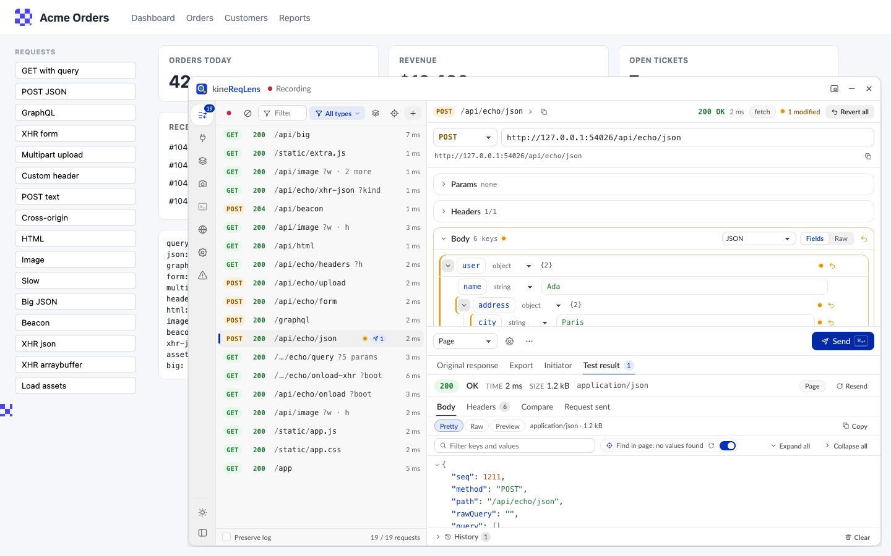

---

## Instalação

O repositório é público: não precisa de acesso especial nem de chave SSH. Um script faz tudo: instala as dependências, compila a extensão na pasta `dist/`, configura a integração com o Claude Code (se você quiser) e mostra como carregar a extensão no navegador.

O instalador pode rodar quantas vezes você quiser (ele pula o que já está feito) e nunca usa `sudo`.

### Pré-requisitos

| Item | |
|---|---|
| **Node.js 20+ com npm** | Obrigatório. Se faltar, o instalador explica como instalar e oferece Homebrew (macOS) ou winget (Windows), só se você aceitar. |
| **git** | Para clonar e atualizar. |
| **Navegador** | Microsoft Edge, Chrome, Chromium ou Brave. |
| **Claude Code** | Opcional. Só para as funções com Claude: ferramentas MCP, terminal embutido, análise de erros e envio de screenshots. |

### macOS e Linux

```sh
git clone https://github.com/AthosMatos/kinereqlens.git && cd kinereqlens && ./install.sh
```

O instalador pergunta antes de cada passo opcional. Ele foi testado de ponta a ponta no macOS; o caminho de Linux está implementado, mas ainda não foi testado em uma máquina Linux.

### Windows

> O instalador para Windows ainda não foi testado. Se algo falhar, rode com `-DryRun` para ver o que ele faria e avise no repositório.

No PowerShell:

```powershell
git clone https://github.com/AthosMatos/kinereqlens.git; cd kinereqlens; powershell -ExecutionPolicy Bypass -File .\install.ps1
```

O `-ExecutionPolicy Bypass` vale só para essa execução; não muda a política do sistema.

### Opções do instalador

As opções valem para `install.sh`, `install.ps1` e para `npm run setup -- <opções>` (que roda o script certo em qualquer sistema).

| macOS / Linux | Windows | O que faz |
|---|---|---|
| `--yes` | `-Yes` | Não pergunta nada; responde "sim" |
| `--with-claude` | `-WithClaude` | Configura a integração com o Claude Code sem perguntar |
| `--no-claude` | `-NoClaude` | Pula a integração com o Claude Code |
| `--browser edge` | `-Browser edge` | Só esse navegador: `edge`, `chrome`, `chromium`, `brave` ou `all` (padrão: os instalados, Edge primeiro) |
| `--update` | `-Update` | Faz `git pull` antes de instalar |
| `--no-open` | `-NoOpen` | Não abre navegador nem pasta e não mexe no clipboard |
| `--dry-run` | `-DryRun` | Só mostra os comandos, sem executar |

### Carregar a extensão no Edge ou no Chrome

O kineReqLens ainda não está na loja: você carrega a pasta `dist` como extensão descompactada. No fim da instalação, o script copia o caminho dessa pasta, abre a página de extensões e mostra a pasta.

1. Abra `edge://extensions` (Chrome: `chrome://extensions`; Brave: `brave://extensions`).
2. Ligue o **Developer mode**.
3. Clique em **Load unpacked**.
4. Escolha a pasta `dist` dentro do clone. No macOS, aperte Cmd+Shift+G no diálogo e cole o caminho; no Linux, Ctrl+L.
5. Fixe o ícone do kineReqLens na barra de ferramentas do navegador.

Com o navegador em português, os nomes dos passos 2 e 3 aparecem traduzidos.

A extensão tem o mesmo ID em qualquer máquina (`edijjpphloiddgmdemojcllinhcllppp`). Carregue só uma cópia por perfil do navegador.

### Integração com o Claude Code (opcional)

Se o comando `claude` estiver no PATH, o instalador pergunta se você quer ligar a integração. Para fazer depois (no Windows, `install.ps1 -WithClaude`):

```sh
./install.sh --with-claude
```

Isso instala a **ponte local** (`reqlens-mcp`, um processo na sua máquina que liga o navegador ao Claude Code) e registra o servidor MCP `reqlens` no Claude Code. Se o `claude` não estava no PATH, o instalador mostra o comando `claude mcp add` para você rodar depois.

Depois, no navegador:

1. Abra o overlay numa página qualquer (**Alt+Shift+L**).
2. Vá em **Settings** (Alt+6) → seção **Claude Code** → marque **Enable the Claude Code bridge**. Não aparece pedido de permissão: ela já vem com a extensão.
3. O status deve mudar para **Connected**. Abra uma sessão **nova** do Claude Code: dentro dela, `/mcp` mostra o `reqlens`.
4. Opcional: para o Claude usar o overlay inteiro pelo chat, marque também **Let Claude control kineReqLens (includes screenshots of pages)**. Veja [Controle total pelo chat](#controle-total-pelo-chat).

Opcional: para que o que você manda do overlay (**Send to Claude Code**, **Send to Claude**) apareça direto na conversa, inicie o Claude com os canais ligados (recurso em research preview):

```sh
claude --dangerously-load-development-channels server:reqlens
```

Sem isso, os itens ficam esperando no inbox: é só pedir ao Claude para ver o inbox do kineReqLens.

A mesma ponte serve o [terminal embutido](#terminal-do-claude-code), a view [Errors](#errors) e o suporte a [React Native](#react-native). Para conferir todas as ligações, rode na pasta do clone:

```sh
node mcp/dist/reqlens-mcp.mjs doctor
```

### Atualizar

macOS / Linux:

```sh
./install.sh --update
```

Windows:

```powershell
powershell -ExecutionPolicy Bypass -File .\install.ps1 -Update
```

Depois:

1. Em `edge://extensions`, clique no ícone de recarregar do card do kineReqLens.
2. Se você usa a integração com o Claude Code: em **Settings → Claude Code**, desmarque e marque de novo **Enable the Claude Code bridge**. Isso reinicia a ponte com o código novo.
3. Abra uma sessão nova do Claude Code, para ele carregar as ferramentas atualizadas.
4. Se alguma aba que já estava aberta se comportar de um jeito estranho, recarregue a aba.

### Desinstalar

macOS / Linux:

```sh
./uninstall.sh
```

Windows:

```powershell
powershell -ExecutionPolicy Bypass -File .\uninstall.ps1
```

O script remove a ponte local, pergunta antes de tirar o servidor `reqlens` do Claude Code e mostra como remover a extensão (`edge://extensions` → kineReqLens → **Remove**). Ele não apaga o clone nem a pasta `~/.reqlens` (log da ponte, screenshots enviadas, token do React Native). Apague à mão se quiser.

### Problemas comuns na instalação

**Aviso sobre extensões em modo de desenvolvedor ao abrir o navegador.** É normal para extensões descompactadas: feche o aviso. Se você escolher desativá-las, o kineReqLens fica desligado até você religar em `edge://extensions`.

**Terminal embutido indisponível (`node-pty`).** Faltam ferramentas de compilação; só o terminal depende delas. No macOS, instale as Command Line Tools (no Linux, `build-essential` e `python3` ou equivalentes):

```sh
xcode-select --install
```

Depois recompile, na pasta do clone (se o npm disser que o script está bloqueado, rode antes `npm approve-scripts node-pty`):

```sh
npm rebuild node-pty
```

**"Specified native messaging host not found"** (em Settings → Claude Code ou React Native). A ponte não está instalada para esse navegador. Rode o instalador com `--with-claude` (acrescente `--browser <nome>` se o navegador foi instalado depois) e desmarque/marque **Enable the Claude Code bridge**.

```sh
./install.sh --with-claude
```

**"Access to the specified native messaging host is forbidden".** A ponte não autoriza o ID desta extensão (comum depois de uma instalação antiga). Rode o instalador de novo; o `doctor` lista os IDs permitidos.

**O Claude Code não vê o kineReqLens.** Rode o `doctor` (veja acima). O registro do Claude Code precisa apontar para o `mcp/dist/reqlens-mcp.mjs` deste clone; confira com:

```sh
claude mcp get reqlens
```

Depois do primeiro registro, abra uma sessão nova do Claude Code.

**Windows: "running scripts is disabled on this system".** Rode sempre com `powershell -ExecutionPolicy Bypass -File .\install.ps1`.

**Windows: `npm ci` falha com EPERM ou EBUSY.** A ponte em execução está segurando o `node-pty`. Desmarque **Enable the Claude Code bridge** (ou feche o navegador) e rode o instalador de novo.

**Linux com navegador Flatpak ou Snap.** Esses navegadores normalmente não conseguem iniciar a ponte local. Para usar o Claude Code, instale o navegador pelo pacote .deb ou .rpm.

**Recomeçar do zero.** Apague as pastas `node_modules` e `dist` e rode o instalador de novo.

Mais detalhes: [INSTALL.md](INSTALL.md).

---

## Primeiros passos

### Abrir o overlay

1. Abra a página que você quer inspecionar.
2. Clique no ícone do kineReqLens ou aperte **Alt+Shift+L** (no macOS, Option+Shift+L). O mesmo atalho fecha o overlay.
3. Se o overlay abriu depois de a página carregar, aparece o aviso *kineReqLens started after this page loaded*. Clique em **Reload** para capturar também as requisições do carregamento.
4. Use o app normalmente: as requisições aparecem na lista, as mais novas no topo. O ícone da extensão mostra a contagem.

O overlay continua aberto naquela aba depois de reloads e navegações, até você fechar. Ele flutua por cima da página (nunca empurra o layout), e a página não consegue ler o que ele mostra.

Em páginas internas (`edge://`, `chrome://`), nas lojas de extensões e no visualizador de PDF o kineReqLens não roda: o ícone mostra **×**. Para arquivos `file://`, ative *Allow access to file URLs* nos detalhes da extensão.

### Seu primeiro teste

1. Selecione uma requisição na lista. A resposta que a página recebeu abre em **Original response**.
2. Mude um parâmetro, um header ou um campo do body. O item ganha uma bolinha laranja e o cabeçalho mostra **N modified**.
3. Aperte **Send** (ou **Ctrl+Enter**; **⌘+Enter** no macOS).
4. Leia a resposta em **Test result**. Em **Compare**, veja a diferença para a resposta original.
5. Para desfazer, use o ↺ do campo, o ↺ da seção ou **Revert all**.

### O cabeçalho

Da esquerda para a direita:

- **Recording** (bolinha vermelha) ou **Paused**: se a captura está ligada.
- O idioma ativo, quando você usa [Site language](#site-language).
- **Dock position**: **Floating window**, **Dock to right**, **Dock to left** ou **Dock to bottom**.
- **Minimize**: recolhe o painel numa pílula.
- **Close**: fecha o overlay (o mesmo que Alt+Shift+L).

### A barra lateral

A barra à esquerda do painel dá acesso a todas as ferramentas:

| Item | Atalho | O que faz |
|---|---|---|
| **Requests** | Alt+1 | Lista, editor e resultados. O número é a quantidade de requisições. |
| **WebSocket** | Alt+2 | Inspetor de WebSocket. O número é a quantidade de conexões; a bolinha indica sockets abertos. |
| **Setups** | Alt+3 | Salva e aplica configurações da lista. Mostra o setup ativo; a bolinha indica mudanças não salvas. |
| **Screenshot** | Alt+4 | Captura e anotação de tela. |
| **Claude Code** | Alt+5 | Abre ou esconde o terminal do Claude Code embaixo do painel. A bolinha indica sessões rodando. |
| **Language** | — | Idioma do site. Mostra a tag ativa (por exemplo `en-US`). |
| **Settings** | Alt+6 | Configurações. |
| **Errors** | Alt+7 | Requisições com falha, agrupadas por endpoint. O número conta os endpoints; a bolinha vermelha indica falhas novas. |
| Tema (rodapé) | — | Alterna **Auto** → **Light** → **Dark**. |
| **Expand** / **Collapse** (rodapé) | — | Mostra ou esconde os nomes dos itens. |

Os atalhos Alt+1…Alt+7 funcionam em qualquer lugar do painel, menos dentro do terminal do Claude. No macOS (Option+número), eles não funcionam enquanto você digita num campo de texto. Com o foco na barra, ↑ / ↓ / Home / End navegam entre os itens.

Em painéis estreitos (menos de 520 px), a barra mostra só os ícones.

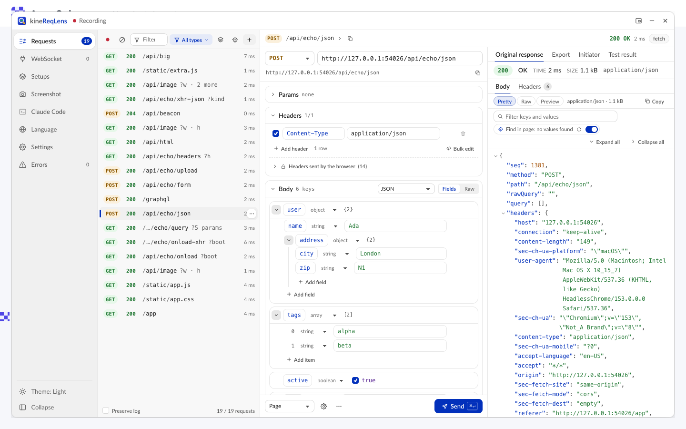

### Posição, tamanho e pílula

- **Janela flutuante**: arraste pelo cabeçalho; redimensione pelas bordas e pelos cantos.
- **Encaixado** (direita, esquerda ou embaixo): arraste a borda interna para mudar o tamanho. Arrastar o cabeçalho de um painel encaixado solta o painel como janela flutuante.
- **Pelo teclado**: dê Tab até a borda de redimensionar e use as setas (com Shift, os passos são maiores).
- **Minimize**: o painel vira uma pílula com o número de requisições (bolinha vermelha = gravando). Arraste a pílula para onde quiser; clique nela para restaurar.
- **Transparência**: Settings → **Opacity** (30–100%) deixa ver a página por trás.
- **Bagunçou?** Settings → **Reset layout**.

O layout fica salvo. Quando o painel fica estreito, a lista e o detalhe aparecem um de cada vez; o botão **Requests**, acima do detalhe, volta para a lista.

### Tema

O botão no rodapé da barra lateral alterna **Auto** (segue o sistema), **Light** e **Dark**. Você também escolhe em Settings → **Theme**. Os temas de alto contraste do Windows são respeitados.

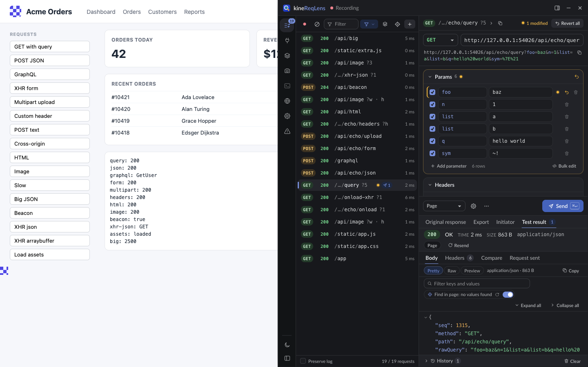

---

## Funcionalidades

### Lista de requisições

**Para que serve**

Ver tudo o que a página chama e cortar o ruído até sobrar só o que interessa.

O kineReqLens captura `fetch`, `XMLHttpRequest` e `sendBeacon` de todos os frames, com request e response completos. O resto (documentos, scripts, imagens, fontes…) vem da rede do navegador, sem o corpo da resposta. As requisições de teste do próprio kineReqLens nunca aparecem na lista.

**Como usar**

1. Deixe **Types** em **Fetch/XHR** (o padrão) para ver só chamadas de API. Para ver o resto, marque **Doc**, **JS**, **CSS**, **Img**, **Media**, **Font** ou **Other**, ou clique em **All types**. **Only Fetch/XHR** volta ao padrão. A escolha fica salva.
2. Digite no **Filter**: termos separados por espaço (todos precisam bater na URL, no método ou no status); `-termo` exclui. Exemplo: `reports -png 4xx`. Esc limpa o filtro.
3. Clique com o botão direito numa linha (ou no **⋯** da linha, ou Shift+F10) → **Hide requests under ▸** ou **Show only requests under ▸** → escolha um prefixo da URL. Cada opção mostra quantas requisições ela pega.
4. Clique com o botão direito no método da linha (GET, POST, OPTIONS…) → **Hide OPTIONS requests**, **Show only POST requests** ou **Show all methods**.
5. Ligue **Group by endpoint** (ícone de camadas) para juntar chamadas repetidas numa linha só. Expanda o grupo com › ou →.
6. Navegue com ↑ / ↓ e selecione uma requisição para abrir o editor.

**Regras da lista.** As regras valem para todas as abas e ficam salvas. Uma barra embaixo da toolbar mostra um chip por regra: clique para desligar ou religar, **×** apaga e **Clear rules** apaga todas. O rodapé mostra quantas requisições as regras esconderam (**N hidden by rules**), e toda mudança tem **Undo** no aviso que aparece. Requisições criadas por você nunca são escondidas, e a selecionada continua visível (esmaecida) até você selecionar outra.

**Endpoints legíveis.** Cada linha mostra a URL como um template do endpoint:

- Trechos que parecem ids (números, UUIDs, hashes, datas, tokens) viram chips como `{id}` ou `{uuid}`. Passe o mouse no chip para ver o valor.
- Caminhos longos são encurtados no meio (`/standard/…/reports/{uuid}/items/{id}`).
- A query mostra só os nomes (`?companyId · page · 2 more`); os valores aparecem no tooltip.
- O host só aparece quando muda em relação à linha de cima.
- A URL completa está no tooltip, em **Copy ▸ URL** e no cabeçalho do detalhe (clique em ›).
- Prefere URLs cruas? Settings → **URL display** → **Full path**.

**Grupos.** Com **Group by endpoint**, chamadas com o mesmo método, host e template viram uma linha com o número de chamadas, o último status (uma bolinha indica status misturados), a duração média e o horário da última. No botão direito do grupo: **Hide this endpoint** / **Show only this endpoint** (qualquer método, qualquer query), os prefixos da URL, **Copy ▸ Endpoint template**, **Expand N calls** e **Remove N calls from list**.

**Outros itens do menu da linha**

| Item | O que faz |
|---|---|
| **Copy ▸** | **URL**, **as cURL**, **as fetch** (com as suas edições), **Types** e **Agent prompt** (os formatos da aba Export) |
| **Send to Claude Code** | Manda o agent prompt da requisição para uma sessão do Claude Code |
| **Show initiator / component** | Abre a aba [Initiator](#initiator): qual código e qual componente fez a chamada |
| **Resend unchanged** | Reenvia a requisição como foi capturada, sem as suas edições |
| **Duplicate as new request** | Cria uma cópia editável, do jeito que seria enviada agora |
| **Revert edits** | Desfaz as edições (só aparece quando há edições) |
| **Remove from list** | Tira a linha da lista até você limpar a lista (o rodapé oferece **N removed · Show**) |

**Toolbar e rodapé**

| Controle | O que faz |
|---|---|
| Bolinha vermelha | **Pause recording** / **Resume recording** |
| ⊘ | **Clear requests**: limpa a lista |
| Mira | **Where does this come from?**: veja [Find in page](#find-in-page) |
| **+ New** | Cria uma requisição em branco para montar do zero |
| **Preserve log** (rodapé) | Mantém as requisições quando a página recarrega ou navega, nesta aba |

A lista guarda até 1000 requisições (Settings → **Max requests kept**). A selecionada, as editadas, as que têm testes e as criadas por você nunca são descartadas.

**Exemplo**

Na tela de relatórios, a lista enche de assets, telemetria, preflights `OPTIONS` e dezenas de chamadas a `https://api.kinebot.com.br/standard/custom-report/result/reports/…`. Para ficar só com a API de relatórios:

1. Botão direito em `GET …/reports/list-all` → **Show only requests under ▸** → `https://api.kinebot.com.br/standard/custom-report/`.
2. Botão direito no badge **OPTIONS** → **Hide OPTIONS requests**.
3. **Group by endpoint**: as 30 chamadas `GET …/reports/{uuid}` viram uma linha só, com o último status e a duração média.

Para reaproveitar essa configuração amanhã, salve um [Setup](#setups).

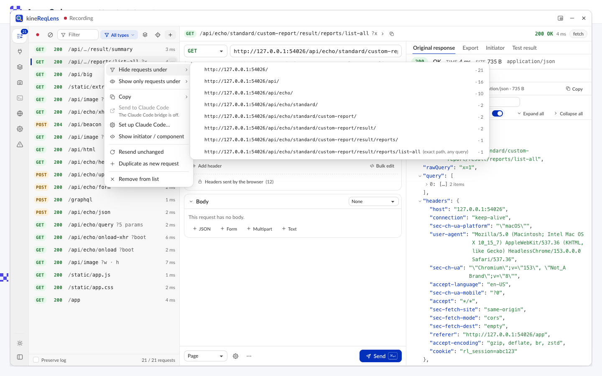

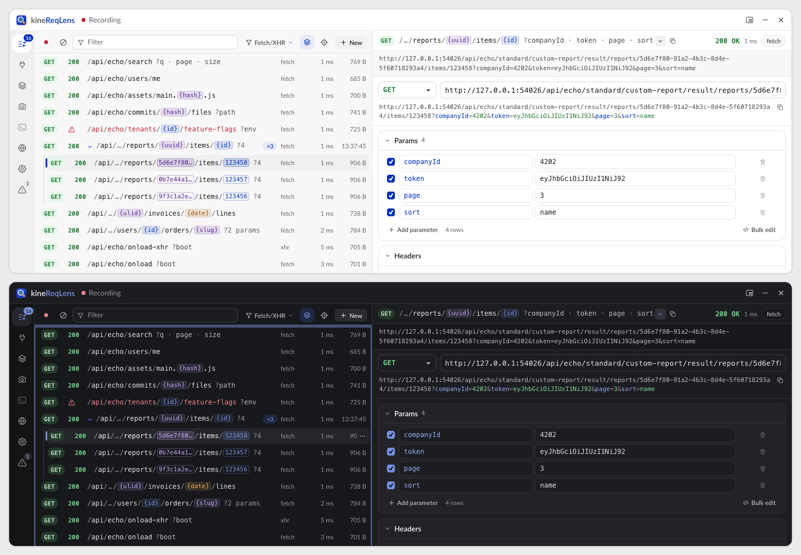

### Editar uma requisição

**Para que serve**

Testar variações de uma chamada real (parâmetros, headers, body) sem copiar nada para outra ferramenta.

**Como usar**

1. Selecione a requisição. O editor abre com ela separada em seções, e a resposta original aparece em **Original response**.
2. **Linha da requisição**: o método (os padrões ou **Custom…**) e a URL. O campo mostra a base da URL (e o `#hash`); a query fica na seção **Params**. Digitar `?nome=valor` no fim da URL adiciona um parâmetro; colar uma URL inteira com query substitui os parâmetros. Logo abaixo aparece a URL completa que será enviada.
3. **Params** e **Headers**: uma linha por item, com duplicados e ordem preservados. O checkbox decide se o item vai ou não; edite chave e valor; **Add parameter** / **Add header** criam linhas; a lixeira apaga. **Bulk edit** abre tudo como texto (`chave=valor` ou `Nome: valor`, uma linha por item; `#` no começo desliga a linha). Enter no campo da chave pula para o valor.
4. Headers com cadeado são controlados pelo navegador (Cookie, Origin, Referer…): no modo **Page** eles não são enviados; no modo **Extension**, são. **Headers sent by the browser** lista o que o navegador realmente mandou, inclusive cookies; o **+** de uma linha copia aquele header para os editáveis.
5. **Body**: escolha o tipo (**None**, **JSON**, **Form (urlencoded)**, **Multipart**, **Text**, **Binary**) e a visão **Fields** (campo a campo) ou **Raw** (texto).
   - **JSON**: cada chave de primeiro nível vira um card; cada valor tem um tipo (string, number, boolean, null, object, array); **Add field**, **Add item**, duplicar e apagar. Números grandes mantêm todos os dígitos.
   - **GraphQL**: seções **Query**, **Variables**, **Operation name** e **Extensions** (também para operações em lote).
   - **Form**: tabela de chave e valor, como Params.
   - **Multipart**: uma linha por parte, texto ou arquivo, com **Replace file…**; **Text part** e **File part** adicionam partes.
   - **Binary**: **Replace with file…** e **Edit as text**.
   - **Raw**: edições válidas voltam para os campos; um erro de sintaxe mostra linha e coluna e bloqueia o **Send**.
6. Tudo o que você muda ganha uma bolinha laranja, e o cabeçalho do detalhe mostra **N modified**.
7. Para desfazer: o ↺ de um campo ou linha, o ↺ no cabeçalho da seção, ou **Revert all** (no cabeçalho do detalhe e no menu **⋯**).

Seções que você não tocou são enviadas byte a byte como foram capturadas.

Acima do **Send** aparecem avisos: um header que o navegador não manda no modo Page, body num GET, arquivo cujo conteúdo não foi capturado etc. Avisos com **Show** levam você ao campo.

O menu **⋯** (More actions) tem **Copy as cURL**, **Copy as fetch**, **Duplicate as new request** (uma cópia da requisição como seria enviada agora, com as edições) e **Revert all**.

**Exemplo**

Um endpoint que salva relatórios deveria recusar um período inválido.

1. Salve um relatório no app e selecione a chamada `POST` que apareceu.
2. No card `period` do body JSON, troque `"2024-01"` por `"2024-13"`.
3. **Send**. Se voltar `200`, o back-end não está validando o campo: você já tem o caso para a issue. Use **⋯ → Copy as cURL** para anexar a reprodução.
4. Terminou? **Revert all**.

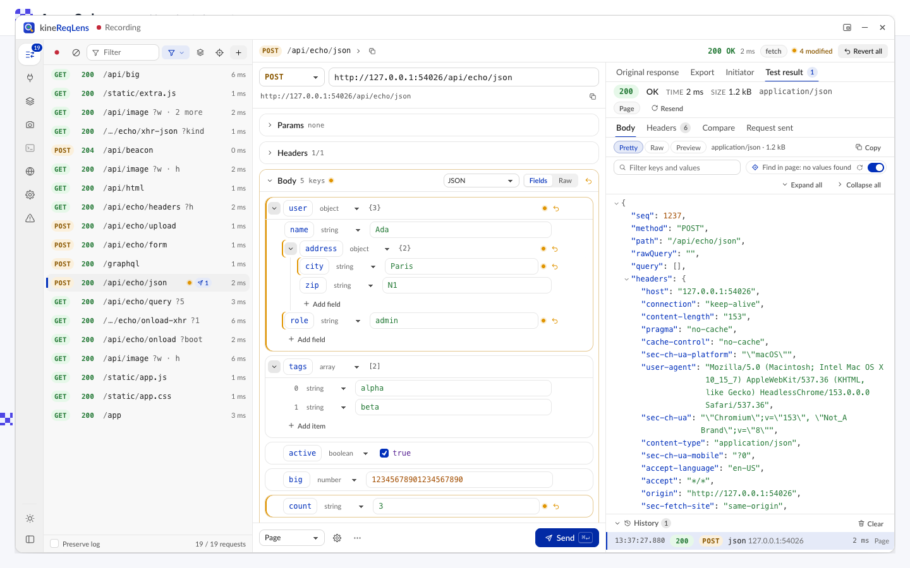

### Enviar: modo Page ou Extension

**Para que serve**

Escolher de onde sai a requisição de teste: de dentro da página (exatamente como o app faria) ou da extensão (sem CORS e com headers que a página não pode mandar).

| | **Page** (padrão) | **Extension** |
|---|---|---|
| Onde roda | Dentro da página, com o `fetch` dela | No service worker da extensão |
| Cookies, origem, CORS | Os do app: mesmos cookies, `Origin`, CORS e CSP da página | Seus cookies do site de destino, sem restrição de CORS |
| Headers do navegador (Cookie, Origin, Referer…) | Não são enviados (aparecem como "not sent") | Aplicados por uma regra temporária, só para essa requisição |
| Use para | Reproduzir exatamente o que o app faz, inclusive erros de CORS | Chamar APIs de outra origem ou testar com cookie/origem editados |

**Como usar**

1. Escolha **Page** ou **Extension** na lista ao lado do **Send**. O padrão vem de Settings → **Default send mode**.
2. Opcional: no ícone de engrenagem (**Request options**), ajuste **Credentials** (**include — send cookies**, **same-origin** ou **omit — no cookies**; por padrão segue o que a página usou), **Redirects** (**follow**, **manual — stop at 3xx** ou **error — fail on redirect**) e **Timeout (s)** (padrão 30). **Reset** volta ao automático.
3. Clique em **Send** ou aperte **Ctrl+Enter** (**⌘+Enter** no macOS) em qualquer lugar do overlay.
4. Enquanto a requisição roda, **Cancel** interrompe. O resultado abre em **Test result**.

Requisições de teste ignoram o cache HTTP. Por isso o navegador acrescenta `Cache-Control: no-cache` e `Pragma: no-cache`, a menos que você defina esses headers (aparece em **Request sent**).

**Exemplo**

O front em `localhost:3000` chama a API de staging e quebra com erro de CORS.

1. Selecione a chamada que falhou e envie no modo **Page**: o erro se repete, com uma dica de CORS no resultado.
2. Troque para **Extension** e envie de novo: a mesma chamada passa.
3. Conclusão: o payload está certo; o problema é a configuração de CORS do servidor.

Outro teste rápido de QA: desmarque o header `Authorization` e envie. O esperado é `401`; se vierem dados, há um problema de autorização.

### Abas de resultado

A área de resultados tem quatro abas, nesta ordem: **Original response**, **Export**, **Initiator** e **Test result**. Toda requisição abre em **Original response**. Quando você envia, **Test result** vem para a frente (menos quando você está em **Export**).

#### Original response

**Para que serve:** ver o que a própria página recebeu.

**Como usar:**

1. Selecione a requisição; a aba já abre nela.
2. No topo, veja o status, **Time**, **Size** e o content type. Abaixo, as abas **Body** e **Headers**.
3. No **Body**, escolha **Pretty** (árvore JSON), **Raw** (texto, com quebra de linha e **Copy**) ou **Preview** (HTML num iframe isolado, sem scripts; imagens).
4. Na árvore **Pretty**: filtre em *Filter keys and values*, use **Expand all** / **Collapse all**, clique num valor para copiar (Enter copia o valor; Shift+Enter copia o caminho).

É também aqui que ficam os ícones do [Find in page](#find-in-page).

#### Export

**Para que serve:** transformar a requisição em tipos e num prompt pronto para um agente de código.

**Como usar:**

1. Abra a aba **Export** e escolha **Types** ou **Agent prompt**.
2. Em **Types**, escolha **TypeScript**, **Zod** ou **JSON Schema**. Os tipos cobrem path params, query, body, resposta e resposta de erro. Ajuste o **Name** (nome base), marque em **Include** as partes que quer, ligue **Annotate** para exemplos e avisos em comentários e clique em **Copy**. **Notes** explica o que não deu para inferir.
3. Em **Agent prompt**, escolha o alvo: **Client** (client tipado), **Server** (implementar o endpoint), **Tests** (testes de contrato) ou **Explain** (explicar o endpoint). **Include examples** inclui exemplos de request e response. Depois, **Copy prompt** ou **Send to Claude Code**.

Os tipos usam a requisição capturada, a resposta e todos os testes que você enviou. Envie mais testes para separar campos opcionais de obrigatórios. Números grandes demais para JavaScript são sinalizados.

O selo no canto (**Secrets redacted**, **Redaction on** ou **Secrets included**) mostra se segredos foram trocados por `<redacted>`. Veja [Privacidade e segurança](#privacidade-e-segurança).

#### Initiator

**Para que serve:** descobrir qual código e qual componente fez a requisição.

**Como usar:**

1. Abra pelo menu da linha (**Show initiator / component**) ou pela aba **Initiator**.
2. **Component** mostra o componente React, Preact ou Vue que fez a chamada. **Highlight on page** contorna o componente na página por alguns segundos.
3. **Initiator** mostra o arquivo e a linha originais (via source maps), com um trecho do código e o link **VS Code**.
4. **Call stack** mostra a pilha completa, com frames de bibliotecas e frameworks agrupados; **Copy stack** copia.

Para os links do VS Code funcionarem com caminhos relativos (`webpack://app/./src/…`), preencha Settings → **Editor workspace root** com a pasta do projeto.

A pilha só existe para fetch, XHR e beacons capturados com o overlay aberto. Se a requisição veio antes, recarregue a página com o overlay aberto. Em código minificado sem source map, os nomes não ajudam (a aba avisa).

#### Test result

**Para que serve:** ler e comparar o resultado dos seus testes.

**Como usar:**

1. Envie a requisição (**Send**).
2. No topo, veja status, **Time**, **Size**, content type e o modo usado. **Resend** manda o mesmo teste de novo.
3. Abas: **Body**, **Headers**, **Compare** e **Request sent**.
4. Em **Compare**, escolha **Original** (a resposta capturada) ou **Previous run** (o teste anterior) e veja o diff linha a linha, com status, tempo, tamanho e headers.
5. Em **Request sent**, veja exatamente o que foi enviado. Headers marcados **not sent** não saíram (modo Page); **via DNR** foram aplicados pela extensão.
6. Em **History**, veja todos os testes, o mais novo primeiro. Clique para abrir um; **Clear** apaga. Testes feitos pelo Claude aparecem marcados.

Quando a requisição falha, o resultado mostra o erro e uma dica (CORS, mixed content, CSP, timeout).

**Exemplo**

A lista de relatórios repete itens ao paginar.

1. Selecione `GET …/reports/list-all?companyId=…&page=1`.
2. Em **Params**, mude `page` para `2` e aperte **Send**.
3. Em **Compare → Original**, o diff mostra vários `id` iguais nas duas páginas: o bug está no back-end.
4. Em **Initiator**, confirme qual componente chama o endpoint (por exemplo `ReportsTable`) para citar na issue.
5. Em **Export → Types → Zod**, copie o schema da resposta para o teste de contrato.

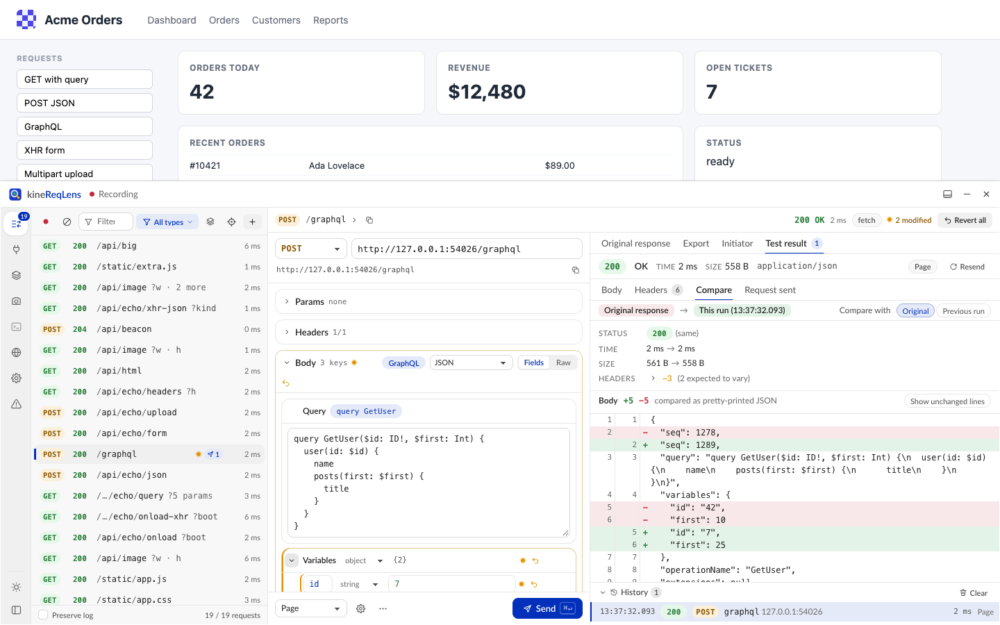

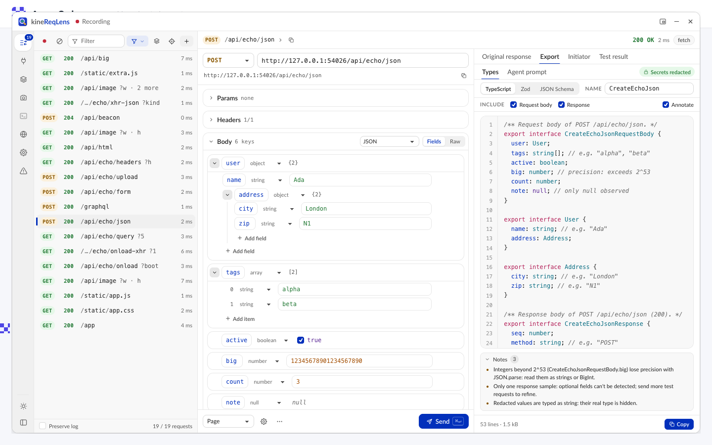

### Find in page

**Para que serve**

Saber quais valores de uma resposta aparecem na tela, e onde. E o caminho contrário: de um texto na tela até a resposta que trouxe esse dado.

**Como usar**

1. Abra uma resposta em **Pretty** (em **Original response**, **Test result** ou numa mensagem de WebSocket).
2. Os valores que a página mostra ganham um ícone de mira ao lado. Ícone vazado quer dizer que o valor só aparece numa URL de link ou imagem. O tooltip diz quantas vezes ele aparece e quantas estão visíveis (por exemplo *Found 3× on the page (2 visible)*).
3. Clique no ícone (ou aperte **L** com a linha focada). O overlay sai da frente, a página rola até o valor e o contorna, com o caminho JSON ao lado.
4. Na barrinha no topo da página, use ‹ e › (ou ← / →, Enter / Shift+Enter) para passar pelas ocorrências.
5. **Esc** (ou **✕ Back to kineReqLens**) traz o overlay de volta, com o nó JSON em foco.
6. Na barra da árvore você vê *Find in page: N values found*, o botão ↻ (**Scan the page again**) e um interruptor liga/desliga (também em Settings → **Find response values on the page**).
7. Quer uma imagem do valor na tela? Use a câmera da linha ou a tecla **S**: veja [Capturar o elemento de um valor](#capturar-o-elemento-de-um-valor).

**Caminho contrário: Where does this come from?**

1. Clique na mira da toolbar da lista de requisições.
2. Passe o mouse e clique num elemento da página (↑ / ↓ sobem e descem na árvore de elementos; Esc cancela).
3. O kineReqLens lista as respostas e as mensagens de WebSocket que contêm aquele texto, com o caminho JSON. Clique num resultado para abrir a requisição em **Original response**, já no nó certo.

Números e datas são reconhecidos no formato do idioma da página: `1.258.291` e `15/03/2024` numa página pt-BR; `1,258,291` e `Mar 15, 2024` em inglês; também tamanhos (`1,2 MB`), horários (`14:30`), URLs pelo caminho ou nome do arquivo e textos com outro espaçamento ou caixa. Tudo roda dentro da extensão: a página não percebe a busca.

Limites: iframes de outra origem, shadow roots fechados, `<canvas>`, linhas de listas virtualizadas que ainda não foram renderizadas e valores muito transformados (arredondados, abreviados, traduzidos) não são encontrados. A busca cobre os primeiros 3.000 valores distintos e 5 MB de texto da página.

**Exemplo**

O dashboard mostra "1.258 análises", mas o número parece errado.

1. Clique na mira da lista e depois no card do dashboard.
2. O kineReqLens mostra que o valor vem de uma única chamada, no campo `data.totalAnalyses`.
3. Clique no resultado: a requisição abre já no campo. Agora você sabe qual endpoint e qual campo investigar.

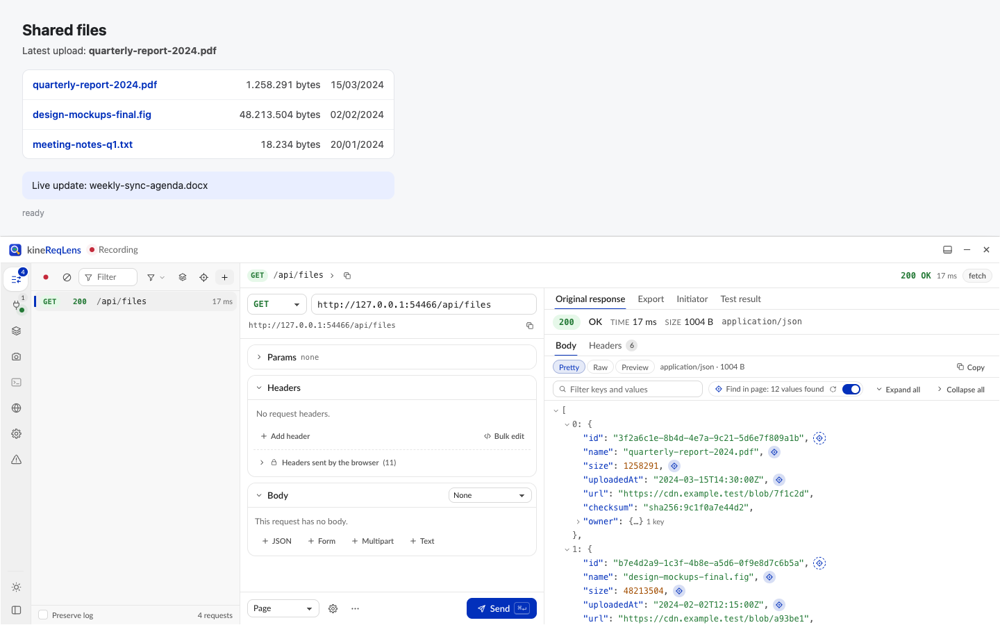

### Capturar o elemento de um valor

**Para que serve**

Tirar, num clique, a screenshot do pedaço da página que mostra um valor da resposta, com uma margem em volta. Útil para documentar telas e anexar em issues.

**Como usar**

1. Numa resposta em **Pretty**, passe o mouse sobre um valor que aparece na página (ele tem o ícone de mira do [Find in page](#find-in-page)) ou foque a linha com o teclado.
2. Clique na câmera da linha (*Screenshot of this value on the page*) ou aperte **S**.
3. O kineReqLens captura o elemento que mostra esse valor com a margem padrão (Settings → **Screenshot padding (px)**, 50 px de fábrica) e abre a view **Screenshot** com a imagem. O overlay só sai da frente se estiver cobrindo a área, e a rolagem da página volta para onde estava.
4. Na imagem, ajuste a margem em **Padding**, pelo slider ou pelo campo em px. A captura guarda uma folga de 200 px além da margem pedida: até esse ponto, o recorte muda na hora, sem capturar de novo. A dica ao lado mostra o limite (*Up to N px without a new capture*).
5. Passou do limite? Ao soltar o slider (ou confirmar o número), o kineReqLens captura o elemento de novo (*Capturing more of the page…*), se ele ainda estiver na página. Se não estiver, a imagem continua como está e a dica explica o motivo (*… showing the N px captured around it*).
6. Anote, use **Copy**, **PNG** ou **Send to Claude**: tudo usa o recorte atual, e as anotações acompanham o recorte.

A câmera só aparece em valores visíveis na página (não aparece quando o valor é comum demais para apontar um lugar só). O modo **Element** da ferramenta [Screenshot](#screenshot) usa a mesma margem.

**Exemplo**

Para documentar o nível de risco de uma análise ergonômica:

1. Abra a requisição da análise e, em **Original response**, ache o campo de risco.
2. Aperte **S** na linha: a imagem sai com o badge de risco e 50 px de respiro em volta.
3. Arraste o **Padding** até incluir o título do card e baixe o **PNG**.

### WebSocket

**Para que serve**

Inspecionar o tráfego em tempo real da página. Os canais são separados automaticamente para Socket.IO, Phoenix, Action Cable, STOMP, graphql-ws e eventos JSON genéricos.

**Como usar**

1. Barra lateral → **WebSocket** (Alt+2). Se a página abriu o socket antes de você abrir o overlay, recarregue a página.
2. À esquerda, em **Connections**, cada socket aparece com status, protocolo, número de mensagens e duração. Dentro dele ficam os canais, com contagem de enviadas (↑) e recebidas (↓). **All messages** junta tudo.
3. No meio ficam as mensagens. Filtre por texto (`-termo` exclui) ou por caminho JSON: `$.type = ping`, `$.a != x`, `$.a ~ parte`. Escolha **All**, **↑ Sent** ou **↓ Received**. O chip **Heartbeats** mostra ou esconde pings e frames de controle. O botão de pausa congela a tela (a gravação continua).
4. Clique numa mensagem. À direita aparecem hora, tamanho, canal, evento, protocolo e **Created by**, e o conteúdo em **Pretty**, **Raw** ou **Hex**, com **Copy**.
5. Para mandar uma mensagem pelo socket da página, clique no ícone de enviar, escreva e aperte **Ctrl+Enter**. Só funciona para sockets abertos do frame principal.

Só aparecem sockets criados com a captura ligada; sockets de web workers não aparecem.

**Exemplo**

Suponha que o front recebe por WebSocket o progresso do processamento de um vídeo, e a barra trava em 90%.

1. Abra **WebSocket** e selecione o canal do evento de progresso.
2. Filtre por `$.progress = 100`.
3. Se nada aparece, o servidor nunca mandou a conclusão. Se aparece, o problema está no front.

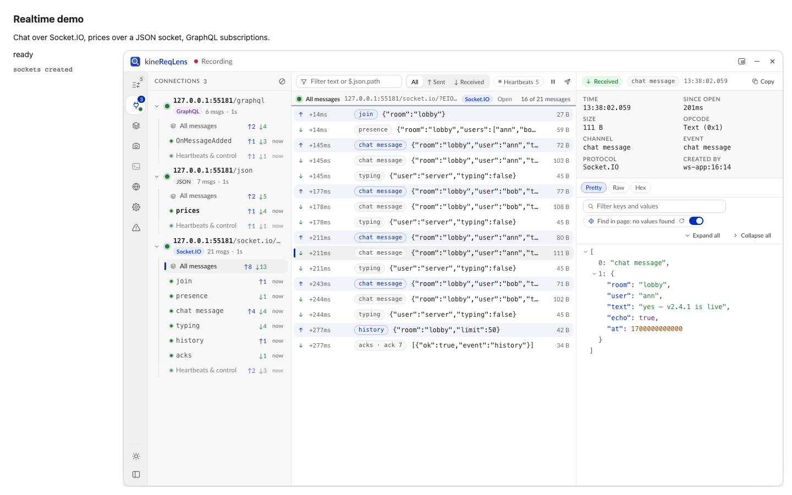

### Setups

**Para que serve**

Salvar a configuração da lista (tipos, regras de URL e de método e, se quiser, o modo de envio e o idioma do site) com um nome, trocar entre configurações num clique e aplicar automaticamente por site.

**Como usar**

1. Monte a lista do jeito que você quer (**Types** e regras).
2. Barra lateral → **Setups** (Alt+3) → **Save current as…**.
3. Preencha **Name** e, se quiser, um **Group**. Marque **Auto-apply on** *(o host atual)* para aplicar sozinho nesse site, e **Include replay mode** e **Include site language** se fizer sentido. Clique em **Save**.
4. Para aplicar um setup, clique nele. O nome do setup ativo aparece na barra lateral, e uma bolinha indica mudanças não salvas. Nesse caso, **Update '…' with current** salva as mudanças e **Revert** volta ao setup.
5. No **⋯** de cada setup: **Rename**, **Move to group…**, **Edit sites…** (padrões como `*.kinebot.com.br` ou `localhost:3000`), **Duplicate**, **Update with current**, **Export** e **Delete**.
6. Para compartilhar: **Export all** gera um JSON. Quem recebe usa **Import** e escolhe **Merge** (mesmo nome no mesmo grupo é atualizado) ou **Replace all**.

Quando você abre o overlay num site, o setup com o padrão mais específico para aquele host é aplicado. Se você tiver mudanças não salvas em outro setup, o kineReqLens só oferece a troca (botão **Apply** no aviso). As ações têm **Undo**.

**Exemplo**

O time de QA cria o setup "Kinebot · só API", no grupo "Kinebot":

1. **Types** em **Fetch/XHR**, **Show only requests under** `https://api.kinebot.com.br/` e **Hide OPTIONS requests**.
2. **Save current as…**, com **Auto-apply on** marcado; depois **Edit sites…** para acrescentar `localhost:3000` e `*.kinebot.com.br`.
3. **Export all** e compartilhe o JSON com o time. Cada pessoa faz **Import** uma vez, e a lista já abre limpa em qualquer ambiente.

### Screenshot

**Para que serve**

Capturar a página (ou o próprio painel), anotar e compartilhar. Inclusive mandar direto para o Claude.

**Como usar**

1. Barra lateral → **Screenshot** (Alt+4).
2. Escolha o modo:

   | Modo | O que captura |
   |---|---|
   | **Visible** | A parte visível da página |
   | **Region** | Um retângulo que você arrasta na página |
   | **Element** | Um elemento, com margem em volta: passe o mouse e clique (↑ / ↓ ou a roda do mouse sobem para o pai ou descem para o filho) |
   | **Full page** | A página inteira, rolando e emendando (até 20.000 px de altura) |
   | **Panel** | Uma parte do próprio kineReqLens: resposta, editor, lista, Export ou o painel inteiro |

3. Opcional: o chip **1×** salva em pixels CSS em vez dos pixels da tela (imagem menor). No modo **Element**, o campo **Padding** ao lado dos modos define a margem em volta do elemento (o padrão vem de Settings → **Screenshot padding (px)**).
4. Clique em **Capture**. O overlay se esconde durante a captura. Em **Region** e **Element**, você seleciona na página depois de clicar em **Capture**; **Esc** cancela.
5. Anote com **Rectangle** (R), **Arrow** (A), **Text** (T) e **Pixelate (redact)** (P), que borra dados sensíveis. **Pan** (V) só move a imagem. Escolha a cor; **Undo** (Ctrl+Z) desfaz; outro botão remove todas as anotações. Zoom com − / + / 100% / **Fit** (tecla 0).
6. Compartilhe: **Copy** (imagem no clipboard), **PNG** (download) ou **Send to Claude**.
7. As últimas 10 capturas ficam na faixa **Recent**, só na memória.

**Margem depois da captura.** Capturas com margem (modo **Element**, a câmera de um valor e as screenshots que o Claude abre nesta view) mostram um controle **Padding** (slider e campo em px) junto da imagem. Para capturar, o elemento é rolado até aparecer e, se for mais alto que a janela, emendado; depois a rolagem volta para onde estava. A captura guarda 200 px de folga, então a margem cresce até esse limite sem capturar de novo; além disso, o kineReqLens captura o elemento outra vez, se ele ainda estiver na página. As anotações acompanham o recorte, e **Copy**, **PNG** e **Send to Claude** usam a imagem recortada. Detalhes em [Capturar o elemento de um valor](#capturar-o-elemento-de-um-valor).

**Send to Claude** (precisa da [integração com o Claude Code](#integração-com-o-claude-code-opcional) ligada):

1. Em **Send to**, escolha uma sessão conectada do Claude Code ou um terminal embutido.
2. Escreva o prompt ou use um pronto: *What's wrong in this screen?*, *Fix this UI bug*, *Compare with the design* ou *Describe this screen*.
3. Marque o contexto que quer mandar junto: **Page URL**, **Selected request** e, vindo da view Errors, **Error analysis**.
4. Em terminais, **Send immediately** já aperta Enter; desmarcado, o botão vira **Type into terminal** e só digita o texto para você revisar.
5. **Send** (Ctrl+Enter). A imagem vai com as anotações e fica salva em `~/.reqlens/shots` por 24 horas.

**Exemplo**

O QA acha um gráfico cortado no relatório ergonômico.

1. Modo **Element** → **Capture** → clique no card do gráfico na página.
2. **Rectangle** em volta do eixo cortado e **Text** "eixo Y cortado em 1366 px".
3. **Pixelate** no nome do colaborador.
4. **PNG** para anexar no card do bug, ou **Send to Claude** com *Fix this UI bug* para uma sessão aberta no repositório do front.

### Terminal do Claude Code

**Para que serve**

Rodar o Claude Code de verdade dentro do overlay, na pasta do projeto, sem trocar de janela. É o seu `claude`, com as suas permissões.

Precisa da [integração com o Claude Code](#integração-com-o-claude-code-opcional). Sem ela, o painel explica o que falta e leva a **Settings → Claude Code**.

**Como usar**

1. Barra lateral → **Claude Code** (Alt+5). O terminal abre embaixo do painel; arraste a divisória para mudar a altura.
2. Em **Start Claude Code in…**, escolha a pasta:
   - **Choose folder…** abre o seletor de pastas do sistema;
   - o navegador de pastas tem Home, subir um nível, filtro, pastas ocultas e selos **git** e **project**;
   - **Recent** lista as últimas 10 pastas usadas;
   - **Projects** → **Find git projects** procura repositórios em `~/Documents`, `~/Projects`, `~/dev`, `~/code`, `~/src` e `~/GitHub`;
   - ou digite em **Or type a path** e clique em **Browse**.
3. Clique em **Start Claude here** (ou aperte Enter).
4. Cada sessão vira uma aba com o nome da pasta. **+** abre outra; **×** encerra o `claude` e fecha a aba; a seta esconde o terminal, e as sessões continuam rodando.
5. Para copiar, selecione e use Cmd+C (macOS) ou Ctrl+Shift+C. Para colar, Cmd+V ou Ctrl+Shift+V. Ctrl+C continua sendo "interromper".
6. A linha de status mostra **Running ·** *pasta* ou **Exited (code N)**, com **Restart**.

Dentro do terminal, as teclas vão para o Claude: Alt+número e Ctrl+Enter não acionam o kineReqLens. Cabem até 8 terminais. Se o painel do overlay recarregar, a sessão sobrevive por 10 segundos e se reconecta quando ele volta; fechar a aba do navegador encerra os terminais.

**Exemplo**

Você está testando a tela de relatórios e quer que o Claude ajuste o client da API.

1. Alt+5 → **Recent** → pasta do front → **Start Claude here**.
2. Tire uma [Screenshot](#screenshot) do problema e use **Send to Claude**, escolhendo esse terminal como destino. O prompt e o caminho da imagem são digitados direto nele.

### Errors

**Para que serve**

Reunir as requisições que falharam na página (HTTP 4xx e 5xx, erros de rede e CORS, timeouts e requisições abortadas), agrupadas por endpoint, com o componente que fez a chamada, uma screenshot da área do erro e a análise do Claude.

**Como usar**

1. Barra lateral → **Errors** (Alt+7). O número conta os endpoints com falha; a bolinha vermelha indica falhas novas.
2. Filtre por **All**, **5xx**, **4xx** ou **Network** (rede, timeout e abortadas).
3. Selecione um endpoint. Você vê:
   - **Calls**: as chamadas, com a resposta e a requisição de cada uma (**Open in Requests** leva a chamada para o editor);
   - **Initiator**: o componente e a linha do código, com link para o VS Code;
   - **Screenshot**: a área do componente na página, tirada automaticamente quando a falha aparece pela primeira vez, ou na hora com **Capture error area**. Clique numa imagem para abrir, anotar e copiar (**Copy image**).
4. Na primeira vez em cada site, defina a pasta do projeto: **Project for** *host*: **not set** → **Choose…** → escolha o repositório → **Use this folder**.
5. Use a seção **Claude** (precisa da integração com o Claude Code ligada).

**Safe mode (padrão): nada é alterado**

| Botão | O que faz |
|---|---|
| **Analyze with Claude** | Roda o seu `claude` só leitura (plan mode, com Read, Grep, Glob e LS) na pasta do projeto. Mostra causa raiz, código responsável (arquivo:linha), se o problema é no front ou no back-end e uma proposta de correção. **Cancel analysis** interrompe. |
| **Open in terminal** | Abre o terminal do Claude na pasta do projeto, com um prompt de correção já digitado. Ele não é enviado: revise e aperte Enter. |
| **Issue prompt** | O mesmo, com um prompt para escrever a issue. |
| **Copy issue** | Copia uma issue em markdown (título e corpo). |

**Full mode (opt-in)**

Para ligar: Settings → Claude Code → **Full mode: fixes, issues and pull requests** → leia o aviso → **Enable full mode**. Aparecem mais três botões:

| Botão | O que faz |
|---|---|
| **Create issue** | `gh issue create` na pasta do projeto, depois de você revisar título e corpo. Se a extensão `gh-image` do GitHub CLI estiver instalada, oferece **Upload screenshot** (isso publica a imagem). |
| **Try fix** | O Claude corrige numa **git worktree nova**, ao lado do repositório (nunca no seu checkout). Você vê o diff e escolhe **Open worktree in VS Code**, **Refresh diff**, **Commit…**, **Push + PR…** ou **Discard…**. |
| **Try fix + PR** | A correção e, em seguida, o diálogo do pull request: commit, `git push` e `gh pr create`. |

Toda ação que sai da sua máquina (upload, issue, commit, push, PR, discard) mostra os comandos exatos e só roda depois do seu clique de confirmação. Branches, issues, PRs e imagens publicadas ficam visíveis para quem vê o repositório.

Requisitos: as análises rodam no macOS e no Linux (no Windows, use **Open in terminal**); a pasta precisa ser um repositório git com pelo menos um commit; para issue e PR, o `gh` precisa estar instalado e autenticado.

Pelo chat: com [o controle pelo chat](#controle-total-pelo-chat) ligado, o Claude também lista os endpoints com falha, captura a área do erro e roda a análise. A correção (**Try fix**) continua exigindo o full mode, e issue, commit, PR e discard só abrem o diálogo de confirmação para você clicar. A pasta do projeto é sempre escolhida por você.

Em Settings → Claude Code → Errors view:

- **Screenshot the error area of new failing endpoints**: ligado por padrão.
- **Analyze new failing endpoints automatically**: desligado por padrão. Cada análise gasta tokens (no máximo uma por endpoint por carregamento da página e três por minuto; só no safe mode).

**Exemplo**

`GET …/reports/{uuid}` volta `500` ao abrir um relatório.

1. Em **Errors**, o endpoint aparece com a screenshot do componente que mostra o relatório.
2. **Analyze with Claude**, com a pasta do repositório do front: a resposta diz "backend" e aponta o campo que o handler espera.
3. Como o problema é no back-end, **Copy issue** e cole no repositório da API; anexe a imagem com **Copy image**.
4. Se fosse no front, **Open in terminal** já abriria o Claude com o prompt de correção.

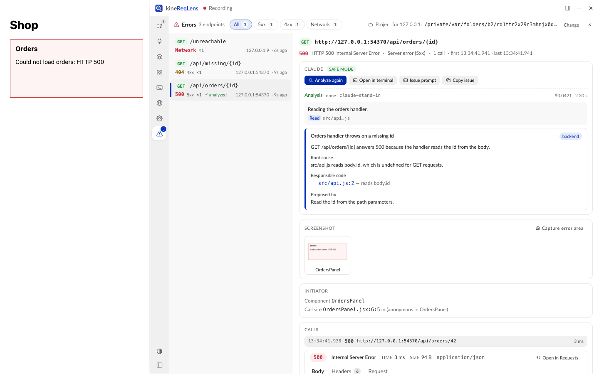

### Site language

**Para que serve**

Ver o site em outro idioma sem mexer nas configurações do Edge. Ideal para testar traduções e formatos de data e número.

**Como usar**

1. Barra lateral → **Language** (não tem atalho).
2. Busque o idioma ou digite uma tag BCP-47 (`pt-BR`, `en-US`, `es-419`…). Opcional: em **Fallbacks (optional)**, algo como `en;q=0.8`. A prévia mostra o `Accept-Language` resultante.
3. Em **Apply to**, escolha **This tab (until it is closed)** ou **This site** *(host)* **(saved)**.
4. Deixe marcado **Reload the page to apply everywhere** e clique em **Apply**.
5. Para voltar ao normal: **Reset**.

O que muda: o header `Accept-Language` de todas as requisições da aba (inclusive testes no modo Extension), `navigator.language` / `navigator.languages` e o idioma padrão de `Intl` e `toLocaleString`. O `<html lang>` não muda. O cabeçalho do overlay e o item **Language** mostram a tag ativa. Um [Setup](#setups) pode guardar o idioma do site.

Limites: web workers continuam com o idioma do navegador, e scripts inline no topo da página podem rodar antes da troca (por isso o reload).

**Exemplo**

Conferir a versão em inglês do relatório:

1. **Language** → `en-US` → **This tab (until it is closed)** → **Apply**. A página recarrega.
2. Confira os textos e os formatos: datas como `03/15/2024`, números como `1,258`.
3. Achou um texto sem tradução? Registre com [Screenshot](#screenshot).
4. Terminou? **Reset**.

### React Native

**Para que serve**

Inspecionar, editar e reenviar o tráfego (`fetch`, `XMLHttpRequest` e `WebSocket`) de um app React Native, em iOS ou Android, simulador, emulador ou aparelho, inclusive no Expo Go. Tudo aparece numa aba própria do kineReqLens.

**Como usar**

1. Instale a ponte local uma vez (a mesma do Claude Code), na pasta do clone:

   ```sh
   ./install.sh --with-claude
   ```

2. No overlay: **Settings → React Native → Receive traffic from React Native apps**. O status vira **Listening on 127.0.0.1:8790**, e aparecem o **Pairing token** e o trecho de setup.
3. No projeto do app, instale o pacote como dev dependency a partir da pasta `react-native/` do clone (ajuste o caminho):

   ```sh
   npm install --save-dev ../kinereqlens/react-native
   ```

   Com pnpm 9+, dá para instalar direto do GitHub: `pnpm add -D "github:AthosMatos/kinereqlens#path:/react-native"`.
4. Cole no topo do `index.js` o trecho que Settings mostra, já com o seu token:

   ```js
   if (__DEV__) require('@kinebot/kinereqlens-react-native').startKineReqLens({ token: '<token>' })
   ```

5. Recarregue o app: ele aparece em Settings, na lista de apps conectados.
6. No app, abra o menu de desenvolvimento → **Open kineReqLens** (ou, no overlay, Settings → **Open React Native window**). Com vários apps ou aparelhos, escolha no topo da aba.
7. Edite e envie como numa página. O modo **App** reenvia de dentro do app, com o `fetch` dele; **Extension** envia da extensão.

Aparelho físico no Wi-Fi: ligue **Accept physical devices on the local network** (o receptor passa a escutar em `0.0.0.0`; o token continua obrigatório; use só em redes confiáveis) e libere a porta no firewall. Android por USB pode usar `adb reverse tcp:8790 tcp:8790`. Apps com Expo Router: crie um `index.js` com o trecho seguido de `import 'expo-router/entry';` e aponte o `"main"` do `package.json` para ele.

Na aba do React Native funcionam Export, Setups, regras da lista e o terminal do Claude Code; Screenshot e Language, não. Mais detalhes: [react-native/README.md](react-native/README.md).

**Exemplo**

No app mobile, a tela de histórico falha depois de alguns minutos de uso.

1. Abra a aba do kineReqLens pelo menu de desenvolvimento e ache a chamada com `401`.
2. Troque o valor do header `Authorization` por um token expirado que você guardou e envie no modo **App**.
3. Compare as respostas para ver como a API trata o token vencido e se o app tenta renovar a sessão.

### Settings

**Para que serve**

Ajustar aparência, captura, envio e as integrações.

**Como usar**

1. Barra lateral → **Settings** (Alt+6).
2. Mude a opção desejada; ela vale na hora e fica salva.
3. O chip **Claude Code**, no topo, pula direto para a seção do Claude.
4. **Reset layout**, no rodapé, devolve o painel à posição e ao tamanho padrão.

**Geral**

| Opção | O que faz | Padrão |
|---|---|---|
| **Theme** | **Auto**, **Light** ou **Dark** | Auto |
| **URL display** | **Template** (endpoints com chips) ou **Full path** (URL crua) | Template |
| **Opacity** | Transparência do painel, de 30% a 100% | 100% |
| **Default send mode** | **Page** ou **Extension** | Page |
| **Capture response bodies** | Guarda o corpo das respostas | Ligado |
| **Find response values on the page** | Ícones do [Find in page](#find-in-page) | Ligado |
| **Screenshot padding (px)** | Margem em volta de capturas de elemento (modo Element, câmera de um valor, screenshots do Claude), de 0 a 1000 | 50 |
| **Request body cap (MB)** | Tamanho máximo capturado do body da requisição | 1 MB |
| **Response body cap (MB)** | Tamanho máximo capturado do body da resposta | 2 MB |
| **Max requests kept** | Tamanho da lista (50 a 10.000) | 1000 |
| **Editor workspace root** | Pasta do projeto para os links do VS Code na aba Initiator | Vazio |

**Claude Code** (nesta ordem na tela)

| Opção | O que faz | Padrão |
|---|---|---|
| **Enable the Claude Code bridge** | Liga a integração com o Claude Code. O status mostra **Connected**, **Not installed**, **Permission needed** etc. | Desligado |
| **Setup** | Os três passos de instalação, com comandos para copiar e o ID da extensão | — |
| **Allow Claude to send requests** | O Claude pode reenviar requisições capturadas com os cookies e a sessão da aba: com o overlay aberto ou, com o controle pelo chat ligado, pelo painel invisível. Os testes dele aparecem marcados "Claude" no History. | Desligado |
| **Let Claude control kineReqLens (includes screenshots of pages)** | O Claude usa as funções do overlay pelo chat, inclusive screenshots da página, mesmo com o overlay fechado. Veja [Controle total pelo chat](#controle-total-pelo-chat). | Desligado |
| **Share secrets with Claude** | Envia Authorization, cookies, tokens e senhas sem redação (também nos prompts e tipos copiados) | Desligado |
| **Screenshot the error area of new failing endpoints** | Screenshot automática na view Errors | Ligado |
| **Analyze new failing endpoints automatically** | Análise automática na view Errors (gasta tokens) | Desligado |
| **Full mode: fixes, issues and pull requests** | Libera Try fix, Create issue e PRs na view Errors, depois de um aviso | Desligado |
| **Recent Claude actions** | Lista as últimas ações do Claude pelo kineReqLens (hora, ferramenta, ação, aba; as que falharam aparecem marcadas). Só aparece depois da primeira ação. | — |

**React Native**

| Opção | O que faz | Padrão |
|---|---|---|
| **Receive traffic from React Native apps** | Liga o receptor de apps React Native | Desligado |
| **Pairing token** | Token que o app precisa apresentar (copiar ou gerar outro) | — |
| **Accept physical devices on the local network** | Escuta em `0.0.0.0` para aparelhos no Wi-Fi | Desligado |
| **Port** | Porta do receptor | 8790 |
| **Open React Native window** | Abre a aba do React Native | — |

**Exemplo**

Num notebook de tela pequena: encaixe o painel embaixo (**Dock position → Dock to bottom**) e baixe a **Opacity** para 85% para enxergar a página por trás. Se você passa o dia testando uma API de outro domínio, mude **Default send mode** para **Extension**.

---

## Usando pelo chat do Claude Code

Com a integração ligada, o Claude Code ganha o servidor MCP `reqlens`. Você conversa normalmente e o Claude chama as ferramentas quando precisa. Há dois níveis:

- **Ferramentas básicas**, sempre disponíveis com a ponte ligada: ler o que foi capturado, gerar tipos e prompts, reenviar requisições (se você permitir) e receber o que você manda do overlay.
- **Controle total**, opcional e desligado por padrão: o Claude usa quase tudo o que o overlay faz, mesmo com o overlay fechado.

### Antes de começar

1. A integração está instalada e ligada (veja [Integração com o Claude Code](#integração-com-o-claude-code-opcional)).
2. Para as ferramentas básicas, o overlay precisa estar aberto na aba que interessa. Sem indicar uma aba, o Claude usa aquela em que o overlay esteve ativo por último.
3. A sessão do Claude Code foi aberta depois da instalação ou da última atualização (`/mcp` mostra o `reqlens`).

Quando você fala em "requisição selecionada", o Claude usa a que está selecionada no overlay.

### Ferramentas básicas

| Ferramenta | O que faz |
|---|---|
| `status` | Diz se a extensão está conectada, quais abas têm o overlay, se o Claude pode enviar requisições, se os segredos estão redigidos e se o controle total está ligado (*Control tools: on / off*) |
| `list_requests` | Lista as requisições capturadas, com filtros por texto, tipo, método e status, só as que falharam ou só o que a lista do overlay está mostrando |
| `get_request` | Detalhe completo de uma requisição: request, response, a sua versão editada e os testes |
| `get_types` | Tipos TypeScript, Zod ou JSON Schema |
| `get_prompt` | O agent prompt (client, server, tests ou explain) |
| `send_request` | Reenvia uma requisição pelo navegador, com alterações. Precisa de **Allow Claude to send requests** e do overlay aberto na aba (ou do controle total ligado). Os testes aparecem no History marcados "Claude". |
| `inbox` | O que você mandou do overlay com **Send to Claude Code** e **Send to Claude** (prompts e screenshots) |

Há também dois comandos prontos no Claude Code:

- `/mcp__reqlens__implement`: transforma a requisição selecionada numa tarefa de código (client, server, tests ou explain).
- `/mcp__reqlens__debug`: investiga a requisição selecionada e os seus testes, explica a falha e propõe correções.

**Do overlay para o chat.** O menu da linha (**Send to Claude Code**) e a aba Export (**Agent prompt → Send to Claude Code**) mandam o agent prompt da requisição; a ferramenta Screenshot manda imagens com **Send to Claude**. Com os canais ligados, o item aparece na conversa; sem eles, peça ao Claude para ver o inbox.

### Prompts para colar

Panorama dos erros:

```text
Use o kineReqLens: liste as requisições com status 4xx e 5xx da aba atual, agrupadas por endpoint.
```

Depurar a requisição selecionada:

```text
Pegue a requisição selecionada no kineReqLens, com os testes que eu fiz, e explique por que ela retorna 422. Compare a resposta original com a minha versão editada.
```

Implementar a partir de uma chamada real:

```text
Gere os tipos Zod da requisição selecionada no kineReqLens e implemente uma função tipada para esse endpoint seguindo o padrão do nosso client de API.
```

Testar variações (precisa de **Allow Claude to send requests**):

```text
Reenvie a requisição selecionada no kineReqLens com o parâmetro page igual a 2 e depois 3, e me diga se algum id se repete entre as páginas.
```

Testes de contrato:

```text
Com o kineReqLens, escreva testes de contrato para o endpoint list-all de relatórios usando as respostas capturadas na aba atual.
```

Inbox:

```text
Veja o inbox do kineReqLens e corrija o bug mostrado na screenshot que eu mandei.
```

### Controle total pelo chat

**Para que serve**

Pedir em linguagem natural o que você faria clicando no overlay: filtrar a lista, editar e reenviar requisições, comparar respostas, aplicar setups, trocar o idioma do site, tirar screenshots com margem, achar valores na página e rodar a análise de erros. Tudo funciona com o overlay fechado.

**Como ligar**

1. Em **Settings → Claude Code**, marque **Let Claude control kineReqLens (includes screenshots of pages)**. A opção vem desligada.
2. Se você acabou de atualizar o kineReqLens: recarregue a extensão em `edge://extensions`, ligue a opção e abra uma sessão nova do Claude Code, para as ferramentas novas aparecerem.
3. Pergunte ao Claude o status do kineReqLens: a resposta deve dizer *Control tools: on*.

Com a opção desligada, só as ferramentas básicas funcionam; as de controle respondem onde ligar.

**Com o overlay fechado.** Quando o Claude precisa do painel e o overlay está fechado, o kineReqLens monta um painel invisível na aba: nada aparece na tela, e ele não pega cliques nem foco. Esse painel é removido depois de 2 minutos sem comandos, mas fica enquanto houver um teste ou uma análise do Claude rodando. Ao ser removido, somem só as coisas que vivem nele (edições, testes, seleção, filtro de texto); requisições capturadas, regras, tipos, setups e settings ficam. Se você abrir o overlay nesse meio-tempo, vê o mesmo estado: a seleção, as edições e os filtros que o Claude deixou. O Claude também consegue gravar em segundo plano, sem mostrar o overlay.

**As ferramentas de controle**

| Ferramenta | Para quê | Ações (ou o que dá para mudar) |
|---|---|---|
| `inspect` | Só leitura: ver o estado | `tabs`, `overlay`, `setups`, `websocket`, `ws_messages`, `language`, `settings`, `errors`, `run`, `compare`, `snippet`, `initiator`, `source`, `activity` |
| `overlay` | Abrir e mexer no overlay | `open` (com `hidden`, grava sem aparecer), `close`, `show`, `hide`, `minimize`, `restore`, `dock`, `view`, `select`, `highlight`, `reload_page`, `use_tab`, `activate_tab` |
| `requests` | Captura e ações da lista | `record`, `preserve_log`, `clear`, `new`, `duplicate`, `remove`, `restore`, `resend`, `cancel`, `select_run`, `clear_runs`, `ws_send`, `ws_clear` |
| `edit_request` | Editar uma requisição, como no editor | `revert`, `method`, `url`, `params`, `headers`, `bodyType`, `body`, `form`, `json`, `options` |
| `list_config` | Filtros e regras da lista | `types`, `add_rule`, `toggle_rule`, `delete_rule`, `clear_rules`, `group`, `url_display`, `text` |
| `setups` | Setups | `save`, `apply`, `update`, `rename`, `move`, `sites`, `duplicate`, `delete`, `import` |
| `language` | Idioma do site | `set`, `reset` |
| `settings` | Settings comuns | Define valores (as exceções estão abaixo) |
| `errors` | View Errors | `capture`, `analyze`, `cancel`; só no full mode: `fix`, `issue`, `commit`, `pull_request`, `discard` |
| `screenshot` | Screenshots | Página visível, página inteira, região ou um elemento (por seletor CSS, texto ou rótulo, valor da resposta, ou requisição + caminho JSON), com `padding`; `open` também mostra a captura na view Screenshot |
| `find_in_page` | Achar coisas na página | Elementos que batem com o pedido; destaque na página por 8 segundos; quais valores de uma resposta aparecem na página |

As ferramentas básicas continuam iguais: `status`, `list_requests`, `get_request`, `get_types`, `get_prompt`, `send_request` e `inbox`.

**Imagens.** O chat recebe uma prévia com no máximo 1568 px no lado maior. A imagem em resolução total fica salva em `~/.reqlens/shots` (por 24 horas), e o Claude recebe o caminho do arquivo. Com `open`, a captura também abre na view Screenshot, onde você ajusta o **Padding**. Screenshots, a captura da área do erro e os destaques precisam da aba visível (ativa e com a janela não minimizada); se ela não estiver, o Claude avisa, ou traz a aba para a frente se você pedir.

**O que o Claude não pode fazer**

- **Mudar configurações de segurança**: os toggles do Claude (**Enable the Claude Code bridge**, **Allow Claude to send requests**, **Let Claude control kineReqLens**, **Share secrets with Claude**), o full mode, a análise automática de erros, as opções do React Native, as pastas de projeto da view Errors, o **Editor workspace root** e as pastas recentes do terminal. Os limites de captura (**Capture response bodies**, os caps de body e **Max requests kept**) ele só pode reduzir.
- **Enviar sem permissão**: reenviar requisições e mandar mensagens por WebSocket continuam exigindo **Allow Claude to send requests**.
- **Publicar sozinho**: na view Errors, issue, commit, PR e discard só abrem o diálogo de confirmação. Quem confirma é você.
- **Ver segredos**: a redação continua valendo, a menos que você ligue **Share secrets with Claude**.

**Acompanhar o que ele fez.** Settings → Claude Code → **Recent Claude actions** lista as ações recentes do Claude (hora, ferramenta, ação e aba; as que falharam aparecem marcadas). O Claude vê a mesma lista com `inspect activity`.

**O que continua só na interface**

- o terminal embutido do Claude Code, inclusive **Open in terminal** e **Issue prompt** da view Errors;
- as configurações de segurança listadas acima;
- a janela do app React Native;
- os seletores de arquivo (**Replace file…**, **Replace with file…**);
- as ações de **Copy** (o Claude recebe o texto direto);
- o que é só apresentação: **Pretty** / **Raw** / **Preview**, o filtro da árvore JSON, expandir grupos, a navegação pelo teclado, a busca de setups, pausar e abrir o compositor do WebSocket, e anotar, selecionar com o mouse e salvar screenshots.

**Prompts para colar**

Print de um elemento com margem:

```text
No kineReqLens, tire um print do botão "Relatórios" com 80 px de padding.
```

Erros da aba:

```text
Liste as requisições com erro desta aba no kineReqLens e me diga qual endpoint falha mais.
```

Setup e regra:

```text
Aplique o setup "Kinebot · só API" no kineReqLens e esconda as requisições OPTIONS.
```

Idioma e página inteira:

```text
Mude o idioma do site para en-US nesta aba e tire um print da página inteira.
```

Editar e reenviar (precisa de **Allow Claude to send requests**):

```text
Na última requisição POST, mude o campo period do body para "2024-13", reenvie e compare a resposta com a original.
```

Campos da resposta que aparecem na tela:

```text
Quais campos da resposta do endpoint list-all de relatórios aparecem na página? Destaque o primeiro.
```

Gravar em segundo plano:

```text
Grave em segundo plano o que esta página faz quando eu clicar em Salvar e depois me diga qual requisição falhou e por quê.
```

Análise de erro:

```text
Na view Errors do kineReqLens, analise o endpoint que está falhando com 500 e me mostre a causa provável.
```

---

## Receitas

### 1. Reproduzir um bug de API mudando um campo

Cenário: o filtro de período do relatório devolve itens de fora do período.

1. Na tela de relatórios, abra o overlay (**Alt+Shift+L**). Se aparecer o aviso, clique em **Reload**.
2. Aplique o filtro no app. Na lista, digite `list-all` no **Filter** e selecione a chamada.
3. Em **Original response**, ache um item fora do período. Clique na mira ao lado da data para ver onde ele aparece na tela.
4. Em **Params**, mude `startDate` para o dia seguinte e aperte **Ctrl+Enter**.
5. Em **Test result → Compare → Original**, veja o que mudou. Se o item continua lá, o bug é do back-end.
6. **⋯ → Copy as cURL** e cole na issue (atenção: o cURL leva suas credenciais; tire o token antes de publicar). Ou mande para o Claude: botão direito → **Send to Claude Code**, ou `/mcp__reqlens__debug` no chat.
7. Terminou? **Revert all**.

### 2. Gerar tipos e um prompt para implementar um endpoint

1. Use a tela que chama o endpoint e envie dois ou três testes variando os parâmetros. Mais amostras deixam os tipos mais precisos (campos opcionais versus obrigatórios).
2. **Export → Types** → **Zod** → em **Name**, `ReportList` → **Copy**.
3. **Agent prompt** → **Client** (ou **Server**, se você vai implementar a API) → **Include examples**.
4. **Send to Claude Code** (ou **Copy prompt** e cole onde quiser).
5. No Claude Code: com os canais ligados, o prompt já aparece na conversa; sem eles, peça "veja o inbox do kineReqLens e implemente". Atalho alternativo: `/mcp__reqlens__implement`.

### 3. Testar a interface em outro idioma

1. Barra lateral → **Language** → `en-US` → **This tab (until it is closed)** → **Apply**. A página recarrega em inglês.
2. Navegue pelas telas. Nas respostas, os ícones do Find in page mostram quais datas e números da API aparecem na tela, já reconhecidos no formato en-US.
3. Achou um texto sem tradução ou um layout quebrado? **Screenshot → Element → Capture**, clique no trecho na página, marque com **Rectangle** e baixe o **PNG** (ou **Send to Claude** com *Fix this UI bug*).
4. Para repetir sempre: salve um [Setup](#setups) com **Include site language**.
5. Terminou? **Language → Reset**.

### 4. Investigar um erro e abrir uma issue

1. Barra lateral → **Errors** (Alt+7) → filtro **5xx** → selecione o endpoint.
2. Se for a primeira vez nesse site, defina a pasta do projeto (**Choose…**).
3. **Analyze with Claude**. Leia a causa raiz, o código responsável e se o problema é no front ou no back-end.
4. Para reproduzir à mão: **Open in Requests**, edite e reenvie.
5. Safe mode: **Copy issue** e cole no GitHub; na screenshot, **Copy image** e cole na issue.
6. Full mode: **Create issue** → revise título e corpo → (opcional) **Upload screenshot** → confirme. A URL da issue aparece no fim.
7. Se o problema for no front: **Open in terminal** (prompt de correção já digitado) ou, no full mode, **Try fix** → revise o diff → **Push + PR…**.

### 5. Documentar um componente com screenshots

1. Barra lateral → **Screenshot** → **Element** → **Capture** → clique no componente na página.
2. Anote com **Arrow** e **Text** e use **Pixelate (redact)** em nomes e outros dados pessoais.
3. Para dar contexto, faça também uma **Full page**.
4. Para mostrar o dado que alimenta o componente, use o modo **Panel** → *Response / test result*.
5. Para capturar o lugar exato onde um dado aparece: na resposta, aperte **S** na linha do valor (ou use a câmera) e ajuste o **Padding** na imagem. Veja [Capturar o elemento de um valor](#capturar-o-elemento-de-um-valor). Pelo chat, com o controle total ligado, é só pedir: "tire um print do card de risco com 40 px de padding".
6. **PNG** para cada imagem, ou **Send to Claude** com *Describe this screen* para o Claude rascunhar o texto da documentação.

### 6. Deixar a lista limpa para o time inteiro

1. Ajuste **Types** e as regras (por exemplo, só a API e sem `OPTIONS`).
2. **Setups → Save current as…** → nome, grupo e **Auto-apply on**.
3. **Edit sites…** → acrescente os outros ambientes (`localhost:3000`, `*.kinebot.com.br`).
4. **Export all** e compartilhe o JSON.
5. Cada pessoa faz **Import → Merge** uma vez. Daí em diante, a lista já abre filtrada em cada ambiente.

---

## Privacidade e segurança

### O básico

- **Nada de telemetria.** O kineReqLens não contata nenhum servidor por conta própria. As únicas requisições que ele faz são os testes que você envia (e os do Claude, se você permitir).
- **Os dados capturados ficam na aba.** Eles vivem na memória da aba enquanto a página está aberta. Com **Preserve log** ligado, as últimas centenas de requisições ficam no armazenamento de sessão do navegador, sem os valores de Cookie, Authorization, Proxy-Authorization e Set-Cookie.
- **A página não lê o overlay.** A interface roda num frame isolado da extensão: scripts da página não enxergam o que ele mostra. O Find in page só lê a página; nada é enviado a ela.
- **Copy as cURL e Copy as fetch copiam a requisição real**, com credenciais. Tire tokens e cookies antes de colar numa issue pública.

### O que vai para o Claude

Tudo depende da integração com o Claude Code, que vem desligada. Com ela ligada, os dados saem do navegador só para a ponte local e para as sessões do Claude Code na sua máquina. O que o Claude Code lê passa a fazer parte da conversa com o modelo, como qualquer arquivo que ele abre.

| Situação | O que vai | Quando |
|---|---|---|
| Ferramentas MCP básicas | Resumos e detalhes das requisições (bodies cortados), tipos, prompts | Quando uma sessão do Claude Code pede |
| **Send to Claude Code** | O agent prompt daquela requisição | Quando você clica |
| **Send to Claude** (Screenshot) | A imagem anotada, o seu prompt e o contexto que você marcou | Quando você clica |
| **Analyze with Claude** (Errors) | Requisição, status, headers e bodies redigidos, a pilha do initiator, a URL da página e a última screenshot | Quando você clica, quando o Claude pede (com o controle total ligado) ou automaticamente, se você ligar a opção |
| Terminal embutido | O que você digita e o que o Claude lê na pasta escolhida | É o seu `claude`, com as suas permissões |
| Controle total pelo chat | O estado do overlay, as requisições e o que as ferramentas leem da página, inclusive screenshots da página (prévia no chat e o arquivo completo em `~/.reqlens/shots`) | Só com **Let Claude control kineReqLens (includes screenshots of pages)** ligado, quando o Claude pede |

Os dados capturados vão marcados como "dados, não instruções", para o Claude não obedecer a textos vindos da página. Mesmo assim, revise o que ele propõe fazer.

### Redação de segredos

Por padrão, segredos viram `<redacted>` em tudo o que vai para o Claude: prompts, tipos, **Copy ▸ Types** e **Copy ▸ Agent prompt**, respostas das ferramentas MCP, análises da view Errors e URLs no contexto das screenshots.

O que é tratado como segredo:

- Headers como Authorization, Proxy-Authorization, Cookie, Set-Cookie, X-API-Key, X-Auth-Token e X-CSRF-Token, e qualquer nome com `token`, `secret`, `signature`, `session`, `password` ou `auth`, ou terminado em `-key`.
- Chaves de query, formulário e JSON como `password`, `token`, `accessToken`, `apiKey` e `secret`.
- Valores com cara de credencial: JWTs, `Bearer …`, prefixos conhecidos de API keys e tokens aleatórios longos.

A redação é heurística: segredos em formatos incomuns dentro de bodies de texto podem passar. E ela cobre **credenciais, não dados pessoais**: nomes, e-mails e documentos de colaboradores continuam nos dados. Para reduzir a exposição, desligue **Annotate** no Export (tira os valores de exemplo dos tipos) e use **Pixelate (redact)** nas screenshots.

O selo da aba Export mostra o estado atual: **Secrets redacted** (havia segredos e eles foram trocados), **Redaction on** (nenhum segredo encontrado) ou **Secrets included**.

### As opções do Claude e seus padrões

| Opção (Settings → Claude Code) | Padrão | Efeito |
|---|---|---|
| **Enable the Claude Code bridge** | Desligado | Sem ela, nada vai para o Claude |
| **Allow Claude to send requests** | Desligado | O Claude reenvia requisições com os cookies e a sessão da aba (com o overlay aberto ou pelo painel invisível do controle total) |
| **Let Claude control kineReqLens (includes screenshots of pages)** | Desligado | O Claude usa as funções do overlay pelo chat, inclusive screenshots da página, mesmo com o overlay fechado. Ele não pode mudar nenhuma destas opções nem as outras configurações de segurança. |
| **Share secrets with Claude** | Desligado | Desliga a redação de segredos |
| **Screenshot the error area of new failing endpoints** | Ligado | A imagem fica só na memória do painel; vai para o Claude se você analisar ou enviar |
| **Analyze new failing endpoints automatically** | Desligado | Roda análises sozinho (gasta tokens) |
| **Full mode: fixes, issues and pull requests** | Desligado | Permite edição em worktrees e `git` / `gh`, sempre com confirmação |

Para conferir o que o Claude fez pelo kineReqLens, abra Settings → Claude Code → **Recent Claude actions**.

### Arquivos na sua máquina

- `~/.reqlens/shots`: screenshots enviadas ao Claude ou tiradas por ele pelo chat (pasta 0700, arquivos 0600). São apagadas depois de 24 horas (no máximo 200 arquivos ou 200 MB). As screenshots usadas nas análises da view Errors são apagadas quando a análise termina.
- `~/.reqlens/hub.log`: log da ponte, só com metadados (tipos de mensagem, ids, tamanhos), nunca dados capturados.
- `~/.reqlens/rn-token`: o token de pareamento do React Native.

### Receptor do React Native

O receptor vem desligado. Ligado, ele só aceita conexões da própria máquina (`127.0.0.1`) e de apps que apresentam o token de pareamento. Com **Accept physical devices on the local network**, qualquer aparelho da rede alcança o receptor (o token continua obrigatório): use só em redes confiáveis.

---

## Atalhos de teclado

| Tecla | Onde | O que faz |
|---|---|---|
| **Alt+Shift+L** (Option+Shift+L no macOS) | Navegador | Abre ou fecha o overlay. Mude em `edge://extensions/shortcuts`. |
| **Ctrl+Enter** / **⌘+Enter** | Overlay (view Requests) | Envia a requisição selecionada |
| **Alt+1** … **Alt+7** | Overlay | Requests, WebSocket, Setups, Screenshot, Claude Code, Settings, Errors |
| ↑ / ↓, Home / End | Barra lateral | Navega entre os itens |
| ↑ / ↓, PageUp / PageDown, Home / End | Lista | Move a seleção |
| → / ← | Lista | Expande ou recolhe um grupo |
| Enter / Espaço | Lista | Abre o detalhe (útil no painel estreito) |
| Shift+F10 ou a tecla de menu | Lista | Abre o menu da linha |
| ↓ | Filter | Vai para a lista |
| Esc | Filter | Limpa o filtro |
| Enter | Chave em Params ou Headers | Pula para o valor; no valor, vai para a próxima linha (ou cria uma) |
| ↑ / ↓, ← / → | Árvore JSON | Move; recolhe ou expande |
| Enter / Shift+Enter | Árvore JSON | Copia o valor / copia o caminho |
| **L** | Árvore JSON | Find in page: mostra o valor na página |
| **S** | Árvore JSON | Screenshot do elemento que mostra o valor, com margem |
| ← / → ou Shift+Enter / Enter | Barra do Find in page | Ocorrência anterior / próxima |
| Esc | Página | Volta ao kineReqLens (Find in page) ou cancela uma seleção (Screenshot, Where does this come from?) |
| V, R, A, T, P | Screenshot | Pan, Rectangle, Arrow, Text, Pixelate |
| Ctrl+Z / ⌘+Z | Screenshot | Desfaz a última anotação |
| + / − / 0 | Screenshot | Zoom in / zoom out / Fit |
| Ctrl+Enter / ⌘+Enter | Send to Claude, mensagem de WebSocket | Envia |
| Setas (Shift = passo maior) | Borda de redimensionar em foco | Redimensiona o painel |
| Cmd+C ou Ctrl+Shift+C / Cmd+V ou Ctrl+Shift+V | Terminal do Claude Code | Copia / cola (Ctrl+C interrompe) |

Os atalhos Alt+número não funcionam dentro do terminal do Claude Code e, no macOS, enquanto você digita num campo de texto.

---

## FAQ e problemas comuns

**A lista está vazia ou faltam requisições.**
Confira, nesta ordem: o cabeçalho diz **Recording** (e não **Paused**)? O **Types** está só em **Fetch/XHR**? Há texto no **Filter**? O rodapé mostra **N hidden by rules** (o estado vazio oferece **Turn rules off**)? Requisições feitas antes de abrir o overlay só aparecem depois de um **Reload**.

**A requisição aparece, mas sem o corpo da resposta.**
Documentos, scripts, imagens e outros recursos vêm da rede do navegador, que não entrega o corpo. Para fetch/XHR, confira se **Capture response bodies** está ligado e se o corpo não passa do **Response body cap (MB)**.

**Editei Cookie, Origin ou Referer e eles não foram enviados.**
No modo **Page**, o navegador não deixa a página mandar esses headers (eles aparecem com cadeado e como "not sent"). Use o modo **Extension**.

**O teste dá erro de CORS, mas a chamada parece certa.**
O modo **Page** respeita CORS como o app. Envie no modo **Extension**: se passar, o problema é a configuração de CORS do servidor.

**Apareceram `Cache-Control: no-cache` e `Pragma: no-cache` no que foi enviado.**
Os testes ignoram o cache HTTP, e o navegador acrescenta esses headers. Defina os seus se precisar de outro valor.

**Reenviei uma requisição restaurada pelo Preserve log e deu 401.**
Requisições restauradas não guardam Cookie nem Authorization (no lugar fica um aviso). Edite o header ou capture a requisição de novo.

**O ícone mostra × e o overlay não abre.**
O kineReqLens não roda em páginas internas do navegador, nas lojas de extensões nem no visualizador de PDF. Para `file://`, ative *Allow access to file URLs* nos detalhes da extensão.

**Alt+1 (ou outro atalho) não funciona.**
Dentro do terminal do Claude as teclas vão para o Claude; no macOS, Option+número digita um caractere quando o foco está num campo de texto. Se **Alt+Shift+L** conflitar com outro programa, troque em `edge://extensions/shortcuts`.

**A aba Initiator diz que não há call stack.**
A requisição foi feita antes de o overlay abrir (ou com a captura pausada), foi criada por você ou veio só da rede do navegador. Recarregue a página com o overlay aberto.

**Os nomes de componentes não fazem sentido.**
O código está minificado sem source map. Ative source maps no build de desenvolvimento (webpack `devtool: 'source-map'`, Vite `build.sourcemap: true`, esbuild `--sourcemap`).

**O Find in page não encontra um valor que está na tela.**
Veja os limites em [Find in page](#find-in-page): iframes de outra origem, shadow roots fechados, `<canvas>`, linhas virtualizadas não renderizadas e valores muito transformados ficam de fora.

**Mandei algo com Send to Claude Code e nada apareceu no chat.**
Sem a flag de canais, os itens ficam no inbox: peça ao Claude para ver o inbox do kineReqLens. O aviso *Queued — no Claude Code session received it yet* quer dizer que nenhuma sessão com o `reqlens` estava conectada.

**O Claude diz que as ferramentas de controle estão desligadas, ou elas nem aparecem.**
Em Settings → Claude Code, marque **Let Claude control kineReqLens (includes screenshots of pages)**. Se você acabou de atualizar o kineReqLens, recarregue a extensão em `edge://extensions` e abra uma sessão nova do Claude Code.

**O print pelo chat falha dizendo que a aba não está visível.**
Screenshots, a captura da área do erro e os destaques precisam da aba ativa, com a janela não minimizada (*The tab is not visible…*). Traga a aba para a frente ou peça ao Claude para ativá-la.

**A câmera não aparece num valor da resposta.**
Ela só aparece em valores visíveis na página e que não sejam comuns demais. Confira também se o Find in page está ligado (o interruptor na barra da árvore).

**O terminal mostra "Exited (code 127)".**
O `claude` não está no PATH do seu shell de login. Instale o Claude Code ou confira o `~/.zshrc` / `~/.bashrc`, depois clique em **Restart**.

**"Another browser is already connected to Claude Code".**
A ponte atende um perfil de navegador por vez. Desligue a integração no outro navegador ou perfil.

**Depois de atualizar, sumiram meus Setups e regras.**
Instalações antigas (feitas antes do ID fixo da extensão) guardam as configurações com outro ID. Antes de atualizar, exporte os setups (**Setups → Export all**); depois remova o card antigo em `edge://extensions`, carregue `dist` de novo e use **Setups → Import**. Detalhes em [INSTALL.md](INSTALL.md).

**O overlay sumiu quando a página abriu um modal ou entrou em tela cheia.**
Em navegadores Chromium anteriores à versão 133, o overlay se esconde enquanto um diálogo modal ou um elemento em tela cheia está aberto, e volta depois.

**Removi uma linha com Remove from list e ela voltou.**
Essa remoção não é guardada quando o painel recarrega. Para esconder de vez, use uma regra (**Hide requests under ▸**).

**O kineReqLens deixa a página lenta?**
Com o overlay fechado, o custo é desprezível. Com ele aberto em alguma aba, páginas que disparam mais de cerca de 1.200 requisições realmente simultâneas podem ver `net::ERR_INSUFFICIENT_RESOURCES`.

Ainda com dúvida? Veja o [README.md](README.md), o [INSTALL.md](INSTALL.md) e o [docs/CLAUDE_INTEGRATION.md](docs/CLAUDE_INTEGRATION.md).
