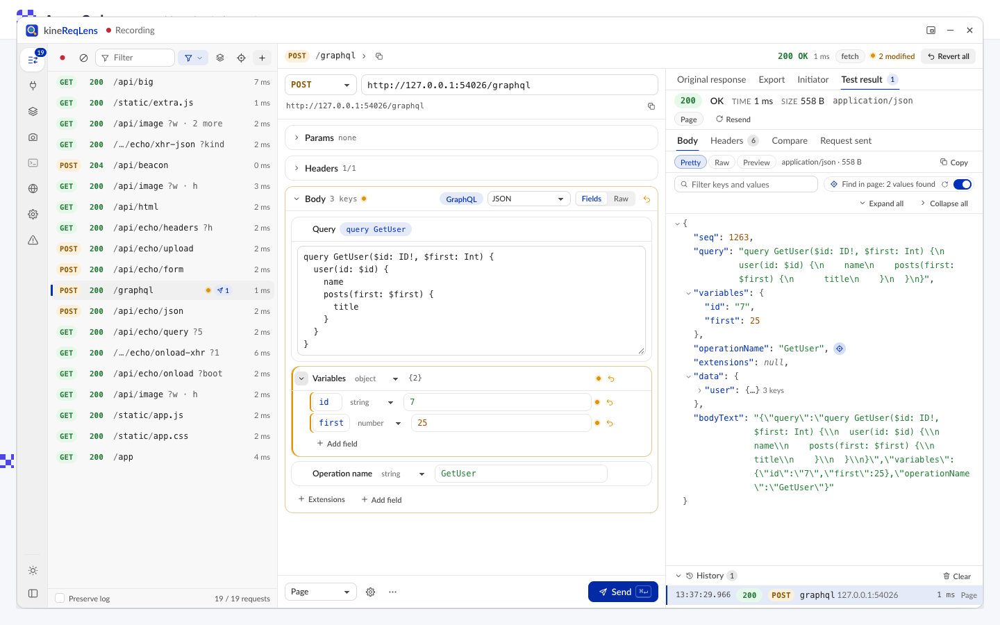

# kineReqLens

> **Guia em português (PT-BR): [GUIA.md](GUIA.md)** — instalação, uso no dia a dia, integração com o Claude Code e
> receitas passo a passo, para devs e QA.

kineReqLens is a browser extension for **Microsoft Edge** (and any Chromium browser 116+) that opens an
always-on-top overlay over the page you are working on and lists every HTTP request that page makes. Select a
request and it is split into editable parts: method, URL, every query parameter, every header, and the body
broken down into its fields (JSON keys, GraphQL query and variables, form fields, multipart parts). Change
anything, revert any change, press **Send**, and the response opens in a test visualizer next to the editor.
You can test API variations without leaving the page or copying requests into another tool.

It also inspects **WebSocket** traffic, shows **which component made a request** (source-mapped stack), turns any
request into **types and an agent prompt**, takes annotated **screenshots**, saves list configurations as
**Setups**, connects to **Claude Code** (MCP bridge and an embedded terminal, optional) and inspects **React
Native** apps in a standalone tab (optional).


| | |
|---|---|
|  |  |
|  |  |
|  |  |
|  |  |

## Features

### Capture
- **fetch, XMLHttpRequest and `navigator.sendBeacon`** are captured in every frame from `document_start`,
  with the full request (headers and body) and the full response (status, headers and body). After a reload,
  the page-load requests are included.
- **Everything else** (documents, form posts, scripts, styles, images, fonts, media, pings, worker fetches)
  comes from `chrome.webRequest`. That includes the headers the browser actually sent (cookies, `sec-*`) and
  the response headers. These entries have no response body.
- A fetch or XHR appears **once**: the network details from webRequest are merged into the page's own capture
  and shown as "Headers sent by the browser".
- Requests from iframes are listed in the top page's list. kineReqLens's own test requests are never listed.
- Each request is tied to the document that made it. When you navigate, the previous page's late requests
  (such as unload beacons) do not show up as requests of the new page.
- List tools: newest first, a text filter (space-separated terms, `-term` excludes), a **Types** dropdown
  (Fetch/XHR by default; tick Doc, JS, CSS, Img, Media, Font, Other or **All types** — remembered), pause/record,
  **preserve log** across navigations, clear, and **+ New** for a blank request. Requests you created, the selected request, and anything with edits
  or test runs are never dropped when the list reaches its size limit.
- Readable endpoints: each row shows its URL as an endpoint template. Id-like segments (numbers, UUIDs, ULIDs,
  hashes, dates, tokens) become chips such as `{id}` or `{uuid}`; hover a chip to see its value. Long paths are
  shortened in the middle to fit the width (`/standard/…/reports/{uuid}/items/{id}`), and the query shows parameter
  names only (`?companyId · page · 2 more`, values on hover). A row shows its host only when it differs from the
  row above (wide lists get a muted host column). The full URL is in the tooltip, under Copy ▸ URL, and in the
  detail header (expand it with ›). Settings → **URL display** → **Full path** shows raw URLs instead.
- **Group by endpoint** (layers button in the toolbar, remembered): requests with the same method, host and path
  template collapse into one row. The row shows the call count, the last status (a dot marks mixed statuses), the
  average duration and the time of the newest call. Expand it (click › or press →) to list the calls with their
  concrete ids. Right-click a group to **Hide this endpoint** / **Show only this endpoint** (any method, any
  query; these rules are saved in Setups too) or to hide by one of its path prefixes.

### Right-click menu and URL rules
Right-click a request (or press Shift+F10 / the ContextMenu key on it, or use its **⋯** button):
- **Hide requests under ▸** and **Show only requests under ▸** offer every path prefix of the request's URL. For
  `https://api.kinebot.com.br/standard/custom-report/result/reports/list-all?x=1` you can pick
  `https://api.kinebot.com.br/`, `…/standard/`, `…/standard/custom-report/`, `…/custom-report/result/`,
  `…/result/reports/` or the exact `…/reports/list-all` (any query). Each choice shows how many requests it
  matches.
- Rules are remembered and apply to every tab. A rules bar under the toolbar shows one chip per rule: click it to
  turn the rule off and on, × deletes it, **Clear rules** removes all. The footer counts the requests hidden by
  rules, and every change can be undone from its toast. Requests you created are never hidden, and the selected
  request stays visible (dimmed) until you select another one.
- **Copy ▸** URL, as cURL, as fetch, types, agent prompt (the Export formats) · **Show initiator / component** ·
  **Send to Claude Code** · **Resend unchanged** · **Duplicate as new request** · **Revert edits** ·
  **Remove from list** (until the list is cleared).
- Right-click a row's **method badge** (GET, POST, OPTIONS…) to **Hide** or **Show only** requests of that method
  (method rules live in the same rules bar).

### Setups
Save the list configuration (types, URL / method rules, optionally the replay mode) as a named **Setup** from the
rail's **Setups** item, group them, and attach host patterns (`*.example.com`, `localhost:3000`): the best match is
applied automatically when you open the overlay on that site. A dot marks unsaved changes; **Export all** (or
**Export** in a setup's ⋯ menu) and **Import** move setups as JSON.

### Site language
The rail's **Language** tool shows a site in another language without touching Edge's settings: pick a language
(searchable list, any valid BCP-47 tag, optional fallbacks such as `pt-BR, en;q=0.8`) for **this tab** (until it is
closed) or **this site** (saved for the host). The tab's requests then carry that `Accept-Language` (a
declarativeNetRequest session rule; extension-mode replays send it too) and the page sees it as `navigator.language` /
`navigator.languages` and the default locale of `Intl` / `toLocaleString`. Apply reloads the page once so the document
request and the page's scripts start with it; **Reset** goes back to the browser's languages. The header shows the
active tag; a setup can carry a site language. Limits: inline scripts at the very top of a page can run before the
override arrives, and web workers keep the browser's language (docs/ARCHITECTURE.md §11).

### Initiator / component
**Show initiator / component** (row menu) opens the **Initiator** tab: the JavaScript stack that started the
request, resolved through the page's source maps to the original file, line and code excerpt (with a VS Code link),
library and framework frames collapsed, and the **React / Preact / Vue component** that made it — **Highlight**
outlines it on the page.

### WebSocket inspector
The rail's **WebSocket** view lists the page's sockets (status, protocol, message counts) and splits their traffic
into channels (Socket.IO, Phoenix, Action Cable, STOMP, graphql-ws, generic JSON events). Filter messages by text or
JSON path (`$.type = ping`), hide heartbeats, pause, inspect a frame as a JSON tree / raw / hex, and send a message
through the page's socket.

### Find in page
In a response's **Pretty** JSON tree (Original response, Test result, WebSocket message), a **locate icon** marks every
value the page shows — as text, as a form value, or in a link / image URL (outlined icon: "Only found in a link / image
URL"). Values are recognised the way pages format them: numbers and dates in the page's language (`1.258.291` and
`15/03/2024` on a pt-BR page, `1,258,291`, `Mar 15, 2024`, `1,2 MB`, `14:30`…), URLs by their path or file name, text
with any spacing or case. The tooltip says how often and how ("Found 3× on the page (2 visible)"). **Click an icon**:
the overlay steps aside, the page scrolls to the match and outlines it with a label naming the JSON path, and a small
bar at the top cycles through the matches (← / → or Enter); **Esc** (or ✕ Back to kineReqLens) brings the overlay back
with that JSON node focused. The tree's toolbar shows "Find in page: 12 values found", a ↻ button (**Scan the page
again**) and an on / off switch (also in Settings); results follow the page as it changes. The **camera** action of a value the page shows (hover the
row, or press **S**) takes a screenshot of the element showing it, with padding around it, and opens it in the
Screenshot view.

**Where does this come from?** (the crosshair button in the request list's toolbar) works the other way round: pick an
element on the page and kineReqLens lists the captured responses and WebSocket messages that contain its text (numbers
and dates read in the page's locale), with the JSON paths — a click opens the request's Original response on that node.
Everything runs inside the extension: the page cannot see the scan (docs/ARCHITECTURE.md §13).


### Screenshot
The rail's **Screenshot** tool captures the visible area, a region, a page element, the full page (scrolled and
stitched) or a part of the kineReqLens panel, then annotates it (rectangle, arrow, text, pixelate to redact) and
copies or downloads it. The last captures stay in a strip until the tab closes.

**Element screenshots with padding**: a picked element (or a response value's element, see Find in page) is captured
with space around it — 50 px by default (Settings → "Screenshot padding (px)", or the **Padding** field next to the
Element mode).
kineReqLens captures a 200 px margin beyond that, so the **Padding** slider of the result changes it right away without
a new capture; going further captures the element again (it is scrolled into view, and stitched when it is taller than
the window). The overlay only steps aside when it covers what is being captured, and the page's scroll position is put
back. With **Let Claude control kineReqLens** on (see below), Claude can do the same from the chat, with the overlay
closed — screenshots of the visible page, the full page, a region or an element found by CSS selector, visible text /
label, a response value or a request + JSON path, and finding / highlighting those elements on the page.

**Send to Claude** (with the Claude Code bridge on; also on the Errors view's screenshots) sends the annotated image
with a prompt — quick prompts: "What's wrong in this screen?", "Fix this UI bug", "Compare with the design",
"Describe this screen"; optionally the page URL, the selected request and the error analysis — to a connected Claude
Code session (it gets the image: channel notification + the `inbox` tool) or to an embedded Claude terminal (the
prompt and the image path are typed in; "Send immediately" presses Enter). The image is saved by the local bridge in
`~/.reqlens/shots` for 24 hours: [docs/CLAUDE_INTEGRATION.md](docs/CLAUDE_INTEGRATION.md#send-a-screenshot-to-claude).

### Export: types and agent prompts
An **Export** tab between Original response and Test result:
- **Types**: TypeScript, Zod or JSON Schema for the path parameters, query, request body, response and error
  response, inferred from the captured request, the captured response and every test run (send more test
  requests to tell optional fields from required ones). Nested objects get their own named types, big integers
  are flagged, the base name is editable, and **Copy** copies the code.
- **Agent prompt**: a ready-made markdown task for a coding agent (write a typed client, implement the
  endpoint, write contract tests, or explain it) with the endpoint, the types, examples and an acceptance
  checklist. **Copy prompt** or **Send to Claude Code**.
- Secrets (auth headers, cookies, tokens, passwords, API keys) are replaced with `<redacted>` unless you turn on
  "Share secrets with Claude" in Settings.

### Claude Code bridge (optional)
Connect kineReqLens to [Claude Code](https://claude.com/claude-code) so Claude can list the captured requests, read
one in full, generate its types or prompt, and (only if you allow it) replay it through the overlay, where the
run shows in the history marked "Claude". **Send to Claude Code** delivers a prompt to a running Claude Code
session. `./install.sh --with-claude` (Windows: `install.ps1 -WithClaude`) sets it up. To set it up by hand:

```sh
npm run mcp:install          # registers the local bridge with your browsers (the extension ID is fixed)
claude mcp add --scope user reqlens -- node "$PWD/mcp/dist/reqlens-mcp.mjs"
```

Then turn on **Settings → Claude Code → Enable the Claude Code bridge**. Details, CLI (`install`, `uninstall`, `doctor`) and the
channels flag: [mcp/README.md](mcp/README.md).

**Let Claude control kineReqLens** (Settings → Claude Code, off by default) gives Claude the rest of the overlay from
the chat, while the overlay stays closed (an invisible panel runs the commands; you see the same state when you open
it): record in the background, list filters and rules, select / edit / resend / compare requests, setups, the site
language, settings, WebSocket messages, the Errors view's flows, screenshots (page, region or an element with padding)
and Find in page — e.g. "screenshot the Order summary box with 20 px around it" or "set quantity to 3 in the last POST
/api/cart, send it and compare". Claude can never change the Claude Code or security settings; sends still need "Allow
Claude to send requests", Errors fixes need full mode, secrets stay redacted, and the recent actions are listed under
Settings → Claude Code. Tools, coverage and safety: [docs/CLAUDE_INTEGRATION.md](docs/CLAUDE_INTEGRATION.md#control-tools).

The rail's **Claude Code** item opens an **embedded terminal** running `claude` in a directory you pick (several
tabs, recent directories remembered), docked under the panel: [docs/CLAUDE_INTEGRATION.md](docs/CLAUDE_INTEGRATION.md).

### Errors view (Claude-powered analysis, optional)
The rail's **Errors** item (badge = distinct failing endpoints on this page, red dot for new ones) groups the failing
requests — HTTP 4xx / 5xx, network / CORS errors, timeouts, aborted — by method + host + path template, with filter
chips (All · 5xx · 4xx · Network), the calls, request / response, the initiator component and its source line, and a
screenshot of the page area of the component that made the request (taken when the failure is first seen).
Pick the site's **project folder** once; then:

- **Safe mode (default)**: **Analyze with Claude** runs your own `claude` read-only (plan mode, Read / Grep / Glob /
  LS) in that folder and shows root cause, responsible code (file:line), frontend vs backend and a proposed fix;
  **Open in terminal** opens the embedded Claude terminal with a fix or issue prompt typed in (not sent); **Copy issue**
  and **Copy image**. Optional: analyze new failures automatically (uses tokens; rate-limited).
- **Full mode (opt-in, Settings → Claude Code → Errors view, behind a warning)**: **Create issue** (`gh issue create`,
  optionally with the screenshot uploaded by the [gh-image](https://github.com/drogers0/gh-image) extension), **Try
  fix** (Claude edits a new git worktree next to your repository; you review the diff, then commit or discard) and
  **Try fix + PR** (commit, `git push`, `gh pr create`). Every outward action shows the exact commands and runs only
  after your confirmation click.


Details: [docs/CLAUDE_INTEGRATION.md](docs/CLAUDE_INTEGRATION.md#errors-view).

### React Native apps (optional)
Inspect, edit and replay the traffic of a **React Native** app (iOS / Android, simulator, emulator or device,
Expo Go included) in a **standalone kineReqLens tab**. The app streams its `fetch`, `XMLHttpRequest` and
`WebSocket` traffic to the local bridge with the JavaScript-only package in [react-native/](react-native/README.md);
replays run **inside the app** (mode **App**, with the app's own fetch) or from the extension (mode Extension).

1. Install the local bridge once (same as for Claude Code): `./install.sh --with-claude` or `npm run mcp:install`.
2. **Settings → React Native → Receive traffic from React Native apps.** The bridge starts a receiver on
   `127.0.0.1:8790` (port configurable) and shows a **pairing token**.
3. Add the package to the app as a dev dependency and call it at the top of `index.js` (Settings shows the snippet
   with your token):

   ```js
   if (__DEV__) require('@kinebot/kinereqlens-react-native').startKineReqLens({ token: '<token>' })
   ```
4. In the app: Dev menu → **Open kineReqLens** (or Settings → **Open React Native window**). The tab lists the
   requests of the app; with several apps or devices connected, pick one at the top.

Physical devices on Wi-Fi need **Accept physical devices on the local network** (listens on `0.0.0.0`; the token is
still required) and the firewall to allow the port; Android over USB can use `adb reverse tcp:8790 tcp:8790`
instead. The Claude Code terminal, Export, Setups and list rules work in the standalone tab too.

### Editable sections
- **Request line**: method (standard or custom) and URL. The URL field shows the base and `#hash`; the query
  string lives in the Params table. Typing `?name=value` after the base adds parameters. Pasting a full URL with
  a query string over the field replaces the parameters.
- **Params** and **Headers**: one row per entry, duplicates and order kept. Each row has an enable checkbox,
  key, value, a modified marker, revert and delete. You can add rows or bulk-edit everything as text.
  Headers the browser controls (Cookie, Origin, …) are marked with a lock.
- **Body**, by type:
  - **JSON**: an editable tree with a card per top-level key, typed values, add / duplicate / delete. Big
    numbers keep every digit, and invalid numbers block Send.
  - **GraphQL**: separate Query, Variables, Operation name and Extensions sections (batched operations too).
  - **Form** (urlencoded): a key/value table.
  - **Multipart**: one row per part, text or file, with "Replace file…".
  - **Text** and **Binary**: binary bodies offer "Replace with file…" and "Edit as text".
  - **Raw** view for every type. Valid edits sync back into the fields; a parse error shows line and column
    and blocks Send.
- **Revert to default** at three levels: per field or row, per section (↺ in the section header), and
  **Revert all**. Sections you did not touch are sent **byte for byte** as captured.
- **Warnings** above Send: headers the browser will not send in Page mode (not shown for App mode in the React
  Native tab, which sends them), a body on GET, files whose content was not captured, and similar.
- More menu: **Copy as cURL**, **Copy as fetch**, **Duplicate as new request** (forks the request as it would be
  sent now, edits included), Revert all.

### Page mode vs Extension mode
Choose the mode next to the Send button. Set the default in Settings.

| | **Page** (default) | **Extension** |
|---|---|---|
| Runs | inside the page, with the page's own `fetch` | in the extension's service worker |
| Cookies, origin, CORS | the app's own: same cookies, `Origin`, CORS checks and CSP as the page | your cookies for the target site, no CORS restrictions |
| Browser-controlled headers (Cookie, Origin, Referer, …) | not sendable (they are listed as "not sent") | applied with a temporary declarativeNetRequest rule scoped to that one request |
| Use it to | reproduce exactly what the app does, including CORS failures | call cross-origin APIs the page cannot read, or test with edited cookies or origin |

Request options (credentials, redirect handling, timeout) can be set for each request. Credentials default to
what the page used for the captured request.

### Test visualizer
- Status, status text, duration, size, content type, the mode used, the final URL after redirects, and notes on
  headers applied through declarativeNetRequest or dropped. A **Cancel** button appears while the request runs.
  Failed requests show the error and a hint (CORS, mixed content, CSP, timeout).
- **Body**: **Pretty** (a collapsible JSON tree with filter and expand/collapse all), **Raw** (wrap, copy), and
  **Preview** (HTML in a sandboxed iframe with no scripts; images). Large bodies render progressively.
- **Headers**, **Compare** (a line diff against the originally captured response or the previous run),
  **Request sent** (exactly what went on the wire, plus Copy as cURL), and a run **History**.
- An **Original response** tab shows what the page itself received.

### Overlay
Floating window (drag, resize) or docked left, right or bottom. Docking never pushes the page layout.
You can also minimize it to a pill that keeps the request count. Opacity is adjustable, and light, dark and
auto themes are available; Windows contrast themes are supported. The layout is remembered. The overlay stays
open across reloads and navigations in the tab until you close it. It stays usable over the page's own modal
dialogs and fullscreen elements.

A navigation rail on the left edge gives one-click access to every tool: **Requests** (Alt+1), **WebSocket** (Alt+2),
**Setups** (Alt+3), **Screenshot** (Alt+4), the **Claude Code** terminal (Alt+5), **Language** (no shortcut),
**Settings** (Alt+6) and **Errors** (Alt+7), plus a theme toggle (auto, light, dark). It shows icons only, or icons
with labels and counts when expanded (the choice is remembered); narrow docks always show icons only.

## Install

kineReqLens is not on the extension stores yet. Clone the repository and run the installer. It needs Node.js 20 or
newer and tells you how to get it:

```sh
./install.sh                                              # macOS / Linux
powershell -ExecutionPolicy Bypass -File .\install.ps1    # Windows
```

The installer:
- installs the dependencies and builds the extension into `dist/`;
- sets up the Claude Code bridge if you want it;
- shows how to load `dist/` unpacked (`edge://extensions` → **Developer mode** → **Load unpacked**).

The unpacked extension has the same ID on every machine (`edijjpphloiddgmdemojcllinhcllppp`, set by the manifest's
`"key"`). Options, updating (`./install.sh --update`), uninstalling and troubleshooting are in
**[INSTALL.md](INSTALL.md)**.

To build by hand: `npm ci && npm run build`, then load `dist/` unpacked; after a rebuild, click the reload button on
the extension's card. `npm run zip` packages `dist/` for a store as `reqlens-<version>.zip`, without the manifest
`"key"` (the store assigns its own ID).

## Usage

1. Open the page you want to inspect and click the kineReqLens toolbar button (or press **Alt+Shift+L**).
2. If the overlay was opened after the page loaded, a banner offers to **Reload**, so that page-load requests
   are captured too.
3. Use the app as usual. Its requests appear in the list, newest first. Filter by text or type.
4. Select a request: its captured response opens in **Original response**. Edit a query parameter, a header or a body field. Modified items get an orange dot, and
   the header shows "N modified".
5. Choose **Page** or **Extension** mode and press **Send** (Ctrl+Enter, or ⌘+Enter on macOS).
6. Read the response in **Test result**. Compare it with the original, check the headers, or look at what was
   sent.
7. Revert one field (its ↺), one section (↺ in the section header), or everything (**Revert all**).

### Keyboard shortcuts
| Keys | Action |
|---|---|
| **Alt+Shift+L** | Toggle the overlay in the current tab (change it at `edge://extensions/shortcuts`) |
| **Ctrl+Enter** / **⌘+Enter** | Send the selected request (anywhere in the Requests view) |
| **Alt+1** … **Alt+7** | Navigation rail: Requests, WebSocket, Setups, Screenshot, Claude Code terminal, Settings, Errors (Language has no shortcut) |
| **↑ / ↓**, Home / End (in the rail) | Move between the rail's items |
| **↑ / ↓**, PageUp / PageDown, Home / End | Move the selection in the request list |
| **Esc** (in the filter) | Clear the filter text |
| **Enter** (in a key field) | Jump to its value |
| **L** (on a response JSON value) | Find in page: show the value on the page |
| **S** (on a response JSON value) | Find in page: screenshot of the element showing the value (with padding) |
| **← / →**, Enter / Shift+Enter · **Esc** (while a value is shown on the page) | Previous / next match · back to kineReqLens |
| Arrow keys on the focused resize edge | Resize the docked panel or floating window |

## Permissions

| Permission | Why |
|---|---|
| `host_permissions: <all_urls>` | Run the capture scripts on the pages you inspect, observe their requests with webRequest, and send Extension-mode test requests to any host |
| `webRequest` | List requests that fetch/XHR hooks cannot see (documents, images, scripts, …) and the headers the browser actually sent |
| `scripting` | Inject the overlay when you open it, and the capture scripts into tabs that were already open when kineReqLens was installed |
| `declarativeNetRequestWithHostAccess` | Apply browser-controlled headers (Cookie, Origin, Referer, …) to an Extension-mode test request, through a temporary rule scoped to that single request and removed afterwards |
| `storage` | Remember settings and layout (`storage.local`), and per-tab state and the preserved log (`storage.session`, cleared when the browser closes) |
| `web_accessible_resources: panel.html` | The overlay UI is an extension page shown in an iframe inside the page, so the page cannot read what the overlay displays |
| `nativeMessaging` | Talk to the local `reqlens-mcp` bridge on your machine. Granted at install (no prompt later), but used only after you enable the Claude Code bridge or React Native support in Settings |

## Privacy

- **No telemetry, no analytics, no remote code.** kineReqLens never contacts any server on its own.
- **The only network requests kineReqLens makes are the test requests you send** with the Send button (and, if you
  enabled the Claude Code bridge and allowed it, the test requests Claude sends, which show in the history).
- **The Claude Code bridge is off by default.** When on, data leaves the browser only to the local bridge process
  and the Claude Code sessions on your machine that ask for it, redacted unless you chose to share secrets. The
  bridge keeps no captured data (it relays over a socket only your user can open).
- **Errors view analyses run only when you click** (or when you turn on automatic analysis, or Claude asks for one
  while you let it control kineReqLens), with your own `claude` in the project folder you chose; captured data in the
  prompt is redacted unless you share secrets. Screenshots handed to a run are written to `~/.reqlens/shots` (0600)
  and deleted when it ends. Nothing is published (issues, pushes, pull requests, image uploads) unless you enabled
  full mode and confirmed that action.
- **Claude's control of kineReqLens is off by default** ("Let Claude control kineReqLens"). When on, screenshots Claude
  takes go only to the Claude Code session that asked (and to `~/.reqlens/shots` like the ones below); Claude cannot
  change the Claude Code / security settings, and its recent actions are listed in Settings → Claude Code.
- **"Send to Claude" screenshots** go only where you send them (a Claude Code session or terminal on your machine):
  the annotated PNG is written to `~/.reqlens/shots` (folder 0700, file 0600) and deleted after 24 hours (at most
  200 files / 200 MB kept).
- **React Native support is off by default.** When on, the local bridge accepts app connections on loopback only (127.0.0.1 / ::1)
  (0.0.0.0 only if you allow LAN devices) and only from apps that present the pairing token; it relays their
  traffic to the extension and keeps nothing. The standalone tab keeps it in memory until it is closed (the
  service worker buffers the latest captures for a tab opened later).
- **Captured data stays in the tab.** It lives in the memory of that tab's content script while the page is
  open, and is gone when the page unloads or the tab closes. With **Preserve log** on, the last few hundred
  entries are kept in the browser's in-memory session storage for that tab. Cookie, Authorization, Proxy-Authorization and Set-Cookie
  values are never written there. Only kineReqLens's service worker can read that storage, and each tab only gets
  its own log back.
- **The page cannot read the overlay.** The UI runs in a cross-origin extension frame, so page scripts cannot
  read the cookies, other frames' traffic or Extension-mode responses shown in it.
- **Find in page only reads the page.** The response values are matched against the page's text inside the extension
  (its isolated world, while you look at a response); nothing is sent to the page or the network, and the highlight and
  bar it draws show the JSON path / value as CSS-generated text in a closed shadow root, which page scripts cannot read.
- Settings (theme, layout, body size caps, …) are stored in `storage.local` and contain no captured data.

## Development

```sh
npm install
npx playwright install chromium   # once, for the end-to-end tests
```

| Script | What it does |
|---|---|
| `npm run build` | Production build into `dist/` (closed shadow root, minified page scripts) |
| `npm run watch` | Unminified build into `dist/` with inline source maps, rebuilt on change |
| `npm test` | Unit tests (vitest, `tests/unit/`) |
| `npm run test:e2e` | Builds `dist-e2e/` and `mcp/dist/`, then runs the Playwright suite (`tests/e2e/`) in headless Chromium with a temporary profile; `RL_BROWSER=msedge npm run test:e2e` runs it in an installed Microsoft Edge |
| `npm run typecheck` | TypeScript checks of the sources, the unit tests, the end-to-end tests and `mcp/` |
| `npm run setup` | Runs the installer for this OS (`install.sh` / `install.ps1`; options after `--`, see [INSTALL.md](INSTALL.md)) |
| `npm run build:mcp` | Bundles the Claude Code bridge into `mcp/dist/reqlens-mcp.mjs` |
| `npm run mcp:install` | Builds the bridge and registers it as a native messaging host. It allows the fixed unpacked extension ID; `-- --extension-id <id>` adds another |
| `npm run check` | typecheck + unit tests + build + build:mcp |
| `npm run zip` | Builds and packages `dist/` as `reqlens-<version>.zip` for Edge Add-ons / the Chrome Web Store (manifest without `"key"`) |

Project layout:

```
src/shared/      contracts: types, message protocol, panel protocol, constants
src/lib/         pure logic: URL / headers / body / JSON-tree / multipart models, drafts, capture matching, cURL,
                 endpoint spec / type generation / redaction / agent prompt (Export, Claude Code)
src/injected/    hook.js — MAIN-world fetch / XHR / sendBeacon / WebSocket hooks, initiator stacks, component lookup,
                 page-mode replays
src/content/     content.js — store, bridge, preserved log, hook channel (every frame)
src/background/  background.js — service worker: tab state, webRequest capture, extension-mode replays + DNR,
                 claude/ — the Claude Code bridge (native port, panel links, call handlers)
src/ui/frame/    ui.js — the in-page overlay host (iframe, top layer, dialogs, zoom) and the panel connection
src/ui/panel/    panel.js — entry of the overlay UI in panel.html, mirroring bridge, hit regions
src/ui/          Preact UI: shell (App, rail, list + context menus + rules, setups, components, styles), detail
                 (editor, initiator), response (visualizer), export, ws (WebSocket inspector), screenshot,
                 terminal (Claude Code), standalone + rn (React Native tab and settings)
mcp/             reqlens-mcp: the Claude Code MCP server, the native messaging hub (+ PTYs, React Native receiver)
                 and the installer
react-native/    @kinebot/kinereqlens-react-native: the in-app capture / replay runtime
static/          manifest, icons, panel.html
tests/unit/      vitest suites;  tests/e2e/  Playwright suites with a local echo server
```

The architecture, contracts and security rules are described in [docs/ARCHITECTURE.md](docs/ARCHITECTURE.md).

## Known limitations

- Requests made before kineReqLens's scripts run in a frame (or in the same task in which you open or pause the
  overlay) are missed by the hooks. webRequest still lists them, without a response body.
- webRequest entries have no response bodies. Streamed responses without a Content-Length are captured for at
  most 5 s.
- While the overlay is open in any tab, a page that fires more than about 1200 truly concurrent requests can hit
  `net::ERR_INSUFFICIENT_RESOURCES`.
- After the service worker restarts, its in-flight webRequest entries may stay pending.
- Test requests bypass the HTTP cache, so the browser adds `Cache-Control: no-cache` and `Pragma: no-cache`
  unless you set them.
- Bulk edit has no escape syntax. An edited multipart/related body is rebuilt as form-data.
- Restored (preserved-log) entries show a placeholder instead of credential values.
- A page's own JavaScript focus trap can take keyboard focus from the overlay. In Chromium older than 133, the
  overlay hides while a page modal dialog or fullscreen element is shown.
- Redaction is heuristic: secrets in unusual formats inside text bodies can slip through. "Remove from list" is
  not remembered across overlay reloads.
- Errors view: Claude runs need macOS / Linux (Windows: use "Open in terminal"); fixes always run in a new git
  worktree, so the project folder must be a git repository with a commit; screenshots only work in the overlay of
  the active, visible tab (not in the React Native tab); a run is cancelled when its overlay panel goes away.
- The Claude Code bridge allows one browser profile at a time, and has been tested on macOS only (Edge and
  Chromium); Windows and Linux support is implemented but untested.
- Find in page cannot see text in cross-origin iframes, closed shadow roots, `<canvas>` or rows a virtualized list has
  not rendered, nor values the page transforms beyond the usual formats (rounded or converted units other than byte
  sizes, abbreviations, translations); the first 3,000 distinct values and 5 MB of page text are searched.

The full list is in [docs/ARCHITECTURE.md §7](docs/ARCHITECTURE.md#7-known-limitations-accepted).

## License

[MIT](LICENSE) © 2026 the kineReqLens project authors.
